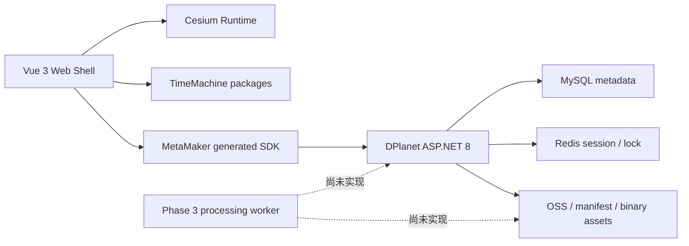

# TimeMachineWeb Agent 工程交接文档

更新日期：2026-08-01

面向对象：接手 TimeMachineWeb 与 DPlanet Server 后续开发的工程 Agent。

## 0. 一页结论

TimeMachineWeb 已完成阶段 0、阶段 1A、阶段 1B、阶段 2，以及阶段 3 的第一个
Point CSV 垂直切片：

- 阶段 0：V2 契约、五张实体定义、三端生成 SDK、V1→V2 只读兼容、能力协商；
- 阶段 1A：Canonical Vue 3 Web Shell、Cesium 数字地球、板块重建、时间轴和本地项目；
- 阶段 1B：邮箱验证码登录、用户信息与退出、公开/私有版本目录、OSS manifest、
  云项目 revision 和并发冲突检测；
- 阶段 2：完整图层组、GPU 点样式与过滤、row ID 拾取、请求取消、LRU、
  两阶段资源释放和图层/样式云端持久化。

阶段 3 的第一个垂直切片也已完成并在本地真实 Server 上端到端验收：

> 登录用户上传 CSV 点数据 → 创建 ProcessingJob → 后台规范化并分配 Plate ID →
> 生成 WGP manifest → 发布新的 DatasetVersion → 自动加入当前项目图层。

详见 `docs/phase-3-point-ingest.md`。下一步是按同一 Job/manifest 契约扩展格式
（Excel、Shape、GPML、ROT、TIF、Raster、图集），不要在 CSV 链路之外另开一套。

关键仓库风险：

- `TimeMachineWeb/` 根目录当前不是 Git 仓库；
- `TimeMachineWeb/DPlanet/` 是 Git 分支 `stage0`，当前 HEAD 为 `c94980e`；
- DPlanet 当前有 114 个修改或未跟踪路径（含 Phase 3 契约、生成产物和手写 Service），
  全部必须保留；
- 不得 reset、checkout 或覆盖这些现有修改；
- 接手 Agent 应由用户决定如何建立可审计的 Git 基线。

本文生成时，Web（5173 端口）与 Server（5130 端口）均已处于运行状态，MySQL（3307）
与 Redis（6379）也已启动。如需重启，见第 8 节。

## 1. 项目目标与当前边界

长期目标是使用纯 Web 技术逐步取代 Unity 客户端，同时继续复用 DPlanet 的账户、权限、
目录、OSS 和项目业务底座。

当前产品边界：



职责划分：

- Web：交互、可见资产请求、GPU 渲染、轻量过滤、项目编辑；
- DPlanet Server：身份、权限、目录、项目 revision、资源版本元数据和授权 URL；
- Processing Worker：文件解析、质量检查、Plate ID 分配、索引、剖分和切瓦片；
- OSS/CDN：原始文件、标准化产物、manifest、WGP、mesh 和瓦片；
- MySQL：元数据和不可变版本关系；
- Redis：登录状态、锁、冷却、Job 进度/事件等瞬态状态。

大数据文件不能通过项目 JSON、Vue 响应式对象或 Cesium Entity 逐条传递。

## 2. 代码与真源

### 2.1 主要目录

| 路径 | 作用 |
| --- | --- |
| `src/AppShell.vue` | Canonical Web UI、登录、资源目录和图层交互 |
| `src/main.ts` | Cesium、时间轴、图层 runtime、点加载与项目编排 |
| `src/project/project-session.ts` | 项目、图层、组、样式和序列化客户端真源 |
| `src/phase1b/cloud-client.ts` | 登录、目录、OSS URL、云项目 revision 客户端 |
| `src/platform-bootstrap.ts` | RPC runtime、Server URL 和能力协商 |
| `packages/reconstruction-core/` | ROT/GPML、重建树、四元数和球面旋转 |
| `packages/cesium-runtime/` | 板块 mesh、矩阵更新、透明度、显隐和拾取 |
| `packages/point-runtime/` | WGP、Worker、GPU 点、style expression、LRU 和拾取 |
| `packages/raster-runtime/` | 图集帧、单幅 Raster、Cesium imagery |
| `packages/api-client/` | 无 UI 依赖的 DPlanet RPC transport |
| `packages/generated-api/` | MetaMaker 生成 Invoker/DTO 的稳定导出边界 |
| `data/` | PALEOMAP、PBDB、Raster、图集输入和本地生成数据 |
| `scripts/` | 点、Raster 和图集的离线制备脚本 |
| `docs/ui-reference/canonical/` | UI 唯一真实实现参考 |
| `DPlanet/MetaMaker2/Define/` | DPlanet Entity、DTO、enum、RPC 唯一契约源 |
| `DPlanet/Server/ServiceDPlanet/Service/TimeMachine/` | TimeMachine 手写业务 Service |
| `DPlanet/TypeScript/src/code_ex/` | MetaMaker 生成 TypeScript SDK，禁止手改 |
| `DPlanet/Unity/Assets/Scripts/CodeEx/` | MetaMaker 生成 Unity SDK，禁止手改 |

### 2.2 必须遵守的真源规则

1. UI 只以 `docs/ui-reference/canonical/index.html` 为唯一设计参考。
2. DPlanet 契约只修改 `DPlanet/MetaMaker2/Define/`。
3. 运行 MetaMaker 生成 Server、TypeScript 和 Unity 产物。
4. 不得直接修改任何 `CodeEx` 文件。
5. 手写 Server 逻辑放在 `Server/ServiceDPlanet/Service/` 等非生成目录。
6. Web 只通过 `@timemachine/generated-api` 使用生成契约。
7. 未经用户明确批准，不修改数据库或表结构。
8. 不把凭据、Token、生产地址或私有基础设施信息写入仓库。

## 3. 已完成内容

### 3.1 阶段 0：契约与兼容层

已定义并生成五个 V2 实体：

| 实体 | 当前用途 |
| --- | --- |
| `PlateModelVersionEntity` | 不可变板块模型版本和 manifest |
| `DatasetVersionEntity` | 不可变数据集版本、模型绑定和 manifest |
| `ProcessingJobEntity` | 处理任务状态、进度、错误和产物；Phase 3 DatasetIngest Job 已有完整 RPC 和 Worker |
| `ProjectRevisionEntity` | 不可变项目 revision、base revision 和 canonical JSON |
| `RasterTileSetEntity` | Raster/图集瓦片集定义；目前只完成契约 |

生成枚举已覆盖：

- `ResourceVersionStatus`: Draft / Processing / Ready / Failed / Retired；
- `DatasetGeometryType`: Table / Point / Line / Polygon / Raster；
- `ProcessingJobType`: PlateModelIngest / DatasetIngest / PlateIDAssignment /
  Triangulation / RasterTiling / LegacyConversion；
- `ProcessingJobStatus`: Queued / Running / Succeeded / Failed / Cancelled；
- `ProjectRevisionStatus`: Draft / Saved / Published。

V1→V2 兼容转换只读，不写旧项目或旧模型。

### 3.2 阶段 1A：Web Shell 与科学计算链路

已完成：

- Vue 3 + Arial + `rgb(42, 130, 228)` Canonical UI；
- 1440×900 主设计分辨率与全视口布局；
- Cesium 球面、相机拖动惯性和归位；
- PALEOMAP ROT/GPML 解析；
- Hamilton 四元数、SLERP、重建树和板块矩阵；
- 503 个板块多边形、约 649,905 个三角形；
- 0–538.8 Ma 时间轴、播放、速度和更大指针命中区；
- 本地项目草稿、时间、相机和图层状态恢复；
- Atlas 与单幅 Raster runtime。

### 3.3 阶段 1B：在线工作区

已完成：

- 邮箱验证码登录；
- Access Token 只进入 `sessionStorage`；
- 当前用户信息与退出；
- 未登录公开 PlateModelVersion/DatasetVersion 目录；
- 登录后 owner/public 目录和云项目目录；
- manifest access token → 临时 OSS URL；
- 项目只保存资源 ID/version，不保存过期签名 URL；
- `CreateProject` 创建 project + revision 1；
- `SaveProject` 使用 `baseRevision`；
- 并发编辑显式返回冲突，不覆盖最新 revision；
- 跨浏览器打开云项目；
- Development-only 本地验收登录模式。

### 3.4 阶段 2：图层与点可视化

已完成：

- `Data layers` / `Reconstruction` 完整图层组；
- 组折叠、组级显隐、组级透明度；
- 图层搜索、层显隐、层透明度；
- 组内/跨组拖拽和持久化；
- Atlas/Raster Cesium imagery 顺序同步；
- 受限、可序列化的 `PointStyleExpression`；
- Plate ID、单值、occurrence 颜色模式；
- 固定/occurrence 大小、圆/方形状；
- Plate ID 与 occurrence 范围过滤；
- 样式只更新 GPU uniform，不重新解析 WGP；
- Worker 请求取消；
- 默认 128 MiB `ArrayBuffer` LRU；
- 卸载立即隐藏，下一帧/idle 再释放资源；
- row ID 拾取 worker，只解码命中的单条 WGP 记录；
- 点样式、组、顺序进入本地草稿和云项目 revision。

当前测试基线：

- Vitest：17 个测试文件，83 项通过 + 5 个 skip（3 个新 live-acceptance 用例仅
  在 `TIMEMACHINE_LIVE_ACCEPTANCE=1` 时运行，另 2 个为历史默认 skip）；
- `npm run build`：通过；
- 275k 点在 100 Ma 显示 275,000 个可见点；
- 10k 点样式、拾取、LRU、两阶段卸载通过；
- 云 revision r1→r2 和旧 revision 冲突通过；
- 浏览器验收页面脚本错误为 0。

## 4. 当前没有完成的内容

Phase 3 的第一个 Point CSV 垂直切片已实现并在本地真实 Server 上跑通端到端
（契约 + Server + Worker + Web 向导 + 发布），代码与验证结果见
`docs/phase-3-point-ingest.md` 第 5.1 节。原第 4.2 节的两个环境阻塞已解除：
`local-acceptance` profile 注入了本地 OSS 根目录，PlateModel 改为通过
`ParseGPML` + `UserPlateModel.Create` 自举，不再需要 `PlateModelVersion`。

以下能力不能被写成“已完成”：

- 真实图形浏览器里的人工点击验收（当前用 `src/phase3/live-acceptance.test.ts`
  打真实 Server 覆盖浏览器传输层，仓库内没有 Playwright/Puppeteer）；
- 大文件分片直传和断点续传；
- CSV 之外的 Excel/Shape/GPML/ROT/TIF 在线 ingest；
- PlateModelVersion 的创建（没有任何 RPC 能创建它；切片已改为不依赖它）；
- RasterTileSet 的处理与在线目录；
- Publish 和 Export；
- 2D Mapping Workspace 接入；
- IndexedDB 草稿层和持久缓存；
- 点空间瓦片、视锥 LOD 和预取；
- 超过 500k 点的空间索引拾取；
- 通用 line/polygon Dataset runtime；
- 真实生产邮件、OSS、数据库的完整端到端上线验收；
- Unity 功能完全切换与下线。

本机 Martin Raster/Atlas 瓦片服务不是 Web 核心进程，未启动时相关 tile proxy 会出现
502。这不影响板块、WGP 点、项目和图层管理，但不能据此验收 Raster 产品链路。

## 5. 当前可直接复用的 DPlanet RPC

所有路径由 MetaMaker 生成 Invoker 定义。Web 不应手写重复 DTO 或字符串路由。

### 5.1 身份和会话

| Invoker | RPC 路径 | 登录 | 当前用途 |
| --- | --- | ---: | --- |
| `LoginMailInvoker.SendMailCode` | `POST /user/login_mail/send_mail_code` | 否 | 发送邮箱验证码 |
| `LoginMailInvoker.Prepare` | `POST /user/login_mail/prepare` | 否 | 验证验证码并准备外部登录关系 |
| `LoginMailInvoker.Login` | `POST /user/login_mail/login` | 否 | 登录/首次创建账户并签发 Token |
| `AccountInvoker.Display` | `POST /user/account/display` | 是 | 恢复与展示当前账户 |
| `AccountInvoker.GetNewToken` | `POST /user/account/get_new_token` | 是 | Token 更新能力，Web 当前未主动调用 |
| `LogoutInvoker.Logout` | `POST /user/logout/logout` | 是 | 服务端退出并清理 Web 会话 |

`LoginMailService` 已复用 Redis 验证码、冷却、账户锁和事务。生产环境不得启用本地验收
固定验证码。

### 5.2 平台能力

| Invoker | RPC 路径 | 登录 | 当前用途 |
| --- | --- | ---: | --- |
| `TimeMachinePlatformInvoker.GetCapabilities` | `POST /d_planet/time_machine_platform/get_capabilities` | 否 | 返回合同版本和功能开关 |
| `TimeMachinePlatformInvoker.RecordTelemetry` | `POST /d_planet/time_machine_platform/record_telemetry` | 否 | 记录有限白名单遥测 |

当前 Server 将全部五个 feature 标记为 enabled；PlateModelVersionV2、
DatasetVersionV2 和 ProjectRevisionV2 可写，ProcessingJobV2 与 RasterTileSetV2
仍为只读。阶段 3 只有在真实写链路完成后才能调整能力标记。

### 5.3 未登录公开目录

| Invoker | RPC 路径 | 登录 | 过滤规则 |
| --- | --- | ---: | --- |
| `TimeMachineCatalogInvoker.DisplayPublicPlateModelVersions` | `POST /d_planet/time_machine_catalog/display_public_plate_model_versions` | 否 | 非 Private、非删除、Ready |
| `TimeMachineCatalogInvoker.DisplayPublicDatasetVersions` | `POST /d_planet/time_machine_catalog/display_public_dataset_versions` | 否 | 非 Private、非删除、Ready，可按模型版本过滤 |

返回值同时包含版本 RO 和 manifest 的 OSS access token。

### 5.4 登录后工作区

| Invoker | RPC 路径 | 用途 |
| --- | --- | --- |
| `TimeMachineWorkspaceInvoker.DisplayPlateModelVersions` | `POST /d_planet/time_machine_workspace/display_plate_model_versions` | owner/public Ready 模型版本 |
| `TimeMachineWorkspaceInvoker.DisplayDatasetVersions` | `POST /d_planet/time_machine_workspace/display_dataset_versions` | owner/public Ready 数据集版本 |
| `TimeMachineWorkspaceInvoker.DisplayLatestProjectRevisions` | `POST /d_planet/time_machine_workspace/display_latest_project_revisions` | 当前用户每个项目的最新 revision |
| `TimeMachineWorkspaceInvoker.GetProjectRevision` | `POST /d_planet/time_machine_workspace/get_project_revision` | owner/public revision 详情 |
| `TimeMachineWorkspaceInvoker.CreateProject` | `POST /d_planet/time_machine_workspace/create_project` | 创建私有项目和 revision 1 |
| `TimeMachineWorkspaceInvoker.SaveProject` | `POST /d_planet/time_machine_workspace/save_project` | owner 写入下一 revision，检测 base revision 冲突 |

`SaveProject` 已使用 Redis project lock、owner 校验和 SQL transaction。冲突返回
`ProjectRevisionSaveRO.Conflict=true` 与当前 revision。

### 5.5 OSS URL

| Invoker | RPC 路径 | 用途 |
| --- | --- | --- |
| `SystemOpenAPIInvoker.GetOssURL` | `POST /system/system_open_api/get_oss_url` | 将 manifest access token 换成短期 URL |
| `SystemOpenAPIInvoker.MD5` | `POST /system/system_open_api/md5` | 小文件/兼容流程 MD5；不应用于浏览器中转超大文件 |
| `SystemOpenAPIInvoker.CreateRequestToken` | `POST /system/system_open_api/create_request_token` | DPlanet 一次性请求 Token 机制，可供敏感写操作薄适配 |

当前 Web 的 `resolveSelectedRuntimeUrls()` 已完成：

- PlateModel manifest → rotation / polygon 相对 URL；
- DatasetVersion manifest → WGP point manifest；
- 项目只存 version ID，运行时再换取 URL。

### 5.6 V1 兼容

| Invoker | RPC 路径 | 用途 |
| --- | --- | --- |
| `TimeMachineCompatibilityInvoker.ConvertPlateModelV1` | `POST /d_planet/time_machine_compatibility/convert_plate_model_v1` | owner/public V1 模型只读转换 |
| `TimeMachineCompatibilityInvoker.ConvertProjectV1` | `POST /d_planet/time_machine_compatibility/convert_project_v1` | V1 项目与指定模型版本只读转换 |

转换结果包含 warning 和稳定内容哈希，不写 V2 数据。

## 6. 阶段 3 可复用但不能直接沿用的接口

这些模块可复用业务规则或内部实现，但当前外部契约不适合大数据产品。

| 模块 | 已有方法 | 可以复用 | 不能直接沿用的原因 |
| --- | --- | --- | --- |
| `UserOssFileInvoker` | `GetOverview`, `Upload`, `UploadByteStream`, `GetUncompleteList` | 配额、OSS 引用、上传状态 | 缺少产品级 presigned multipart/complete 契约 |
| `UserVirtualFileInvoker` | `CreateList`, `Update`, `Display`, `DisplayMine`, `GetList`, `GetURL` 等 | 文件目录、权限和元数据 | 大文件内容仍应直传 OSS |
| `FileParseOpenAPIInvoker` | Excel/CSV/Shape/TIF/GPML/CPT 等解析 | 解析算法和字段映射 | 当前同步全量内存返回，必须包装为 Job |
| `UserProjectInvoker` | Create/Update/Clone/Publish/AccessRange 等 | 旧项目生命周期和权限语义 | TimeMachine 应继续使用 ProjectRevision，不回退整项目覆盖 |
| `UserPlateModelInvoker` | Create/Update/Display/DisplayMine 等 | 模型目录和 owner/public 语义 | **整个模块是 ByteStream RPC，JSON 客户端打不到**；Web 侧改用 `TimeMachineIngestInvoker.DisplayIngestPlateModels` |
| `UserTimeSequenceAtlasInvoker` | Create/Update/Display/Count/Download 等 | 图集目录、帧和权限 | Web 渲染必须新增 RasterTileSet/瓦片 manifest |
| `ColorRampInvoker` / `UserColorRampInvoker` | 目录、下载、访问范围 | 色带预设与权限 | Web 侧需映射到统一 style expression |
| `PublicTableInvoker` / `UserTableInvoker` | 字段、条件、目录和下载 | 字段元数据与小表兼容 | 字符串矩阵不适合百万点 |
| Geo2D point/line/polygon modules | 小批量 CRUD | 用户注释与手工编辑 | 不能承载大规模 Dataset |
| `ScheduleService` | 调度和脚本执行骨架 | worker 调度思路 | 仅 Operator 管理，无用户 Job 进度/重试契约 |

判断某个模块 Web 能不能直接调，只看它的接口上有没有
`[RPC(RequestContentType = ByteStream, ...)]`：有就是二进制传输，`packages/api-client`
只发 JSON，浏览器里必然 400。目前 `UserPlateModelModule`、
`TimeMachineCompatibilityModule`、`TagManageModule` 和大多数 `User*Module` 都是这类。
`TimeMachineIngest/Catalog/Workspace/Platform` 与 `DPlanetManage` 是 JSON。

明确不能作为新平台基础：

- `PlateSkeletonService.GetBoneByModel/GetPlateByModel`：当前是空实现；
- `PlateSkeletonService.DisplayModel`：硬编码占位数据；
- `ExportDataController`：进程内临时字典，重启即丢；
- `UserTable.Value` 全量字符串矩阵；
- Web URL/base64/LocalStorage 传输大文件；
- Cesium 或 Unity 运行时对象序列化。

## 7. 阶段 3 推荐实施计划

### 7.1 Phase 3A：契约评审

目标：在动代码前锁定 Point CSV 最小闭环。

需要明确：

- 上传是复用 `UserOssFile` 小文件能力，还是新增 presigned multipart；
- 是否需要新 UploadSession 实体；
- `ProcessingJobEntity` 现有字段是否足够；
- CSV 必填字段、经纬度/年龄/occurrence/Plate ID 映射规则；
- DatasetVersion manifest v1 结构；
- worker 运行方式、并发、超时、重试、取消和配额；
- 私有/公开/发布权限状态转换。

数据库或表结构有任何变化，必须先向用户说明并得到明确批准。

验收产物：

- 契约说明；
- 状态机；
- manifest 示例；
- RPC 列表；
- 错误码和可重试规则；
- 不包含生产凭据的本地运行说明。

### 7.2 Phase 3B：MetaMaker 契约和 Server 控制平面（已实现，见 `docs/phase-3-point-ingest.md`）

建议新增或补齐生成 RPC：

```text
TimeMachineUpload.CreateUpload
TimeMachineUpload.CompleteUpload
TimeMachineProcessing.CreateDatasetIngestJob
TimeMachineProcessing.DisplayMyJobs
TimeMachineProcessing.GetJob
TimeMachineProcessing.CancelJob
TimeMachineDataset.CreateDraftVersion
TimeMachineDataset.PublishVersion
```

命名可以按 DPlanet 规范调整，但必须覆盖：

- 创建上传/返回直传信息；
- 上传完成和内容哈希；
- 创建 Job；
- 查询/列表/取消；
- owner/public 权限；
- DatasetVersion Draft → Processing → Ready/Failed；
- Ready 后返回 manifest access token。

实现顺序：

1. 修改 `MetaMaker2/Define`；
2. 运行 GeneratorCli；
3. 第二次生成必须 0 new / 0 changed / 0 deleted；
4. 在非 `CodeEx` 目录实现 Service；
5. 添加 C# contract/service tests；
6. 更新 `packages/generated-api` 稳定导出。

### 7.3 Phase 3C：Point CSV Worker（已实现，见 `docs/phase-3-point-ingest.md`）

首个 worker 只处理 Point CSV：

```text
Uploaded
  -> Validate file/hash/size
  -> Parse columns
  -> Normalize rows
  -> Validate coordinate and time range
  -> Assign or validate Plate ID
  -> Encode WGP
  -> Write manifest and quality report
  -> Upload immutable assets
  -> Mark DatasetVersion Ready
```

要求：

- 输入和产物都以内容哈希标识；
- pipeline version 写入 DatasetVersion；
- 不修改原始上传；
- rejected row 有原因和计数；
- 失败写 `ErrorCode/ErrorMessage`，不留下 Ready 半成品；
- 相同 input hash + processor version 可安全复用或拒绝重复；
- worker 不把百万行 JSON 返回给 API。

### 7.4 Phase 3D：Web 上传向导（已实现，见 `docs/phase-3-point-ingest.md`；第 9 项云 revision 保存复用既有机制）

将现有 `Upload to Layer` 从占位改为：

1. 选择 CSV；
2. 展示大小、哈希和字段预览；
3. 映射 longitude / latitude / age / occurrence；
4. 选择 PlateModelVersion；
5. 创建上传和 Job；
6. 显示阶段、进度、错误和取消；
7. Job Ready 后刷新 DatasetVersion 目录；
8. 自动添加 Point layer；
9. 保存云 project revision。

不要把整个 CSV 放入 Vue reactive state。预览只取有上限的少量行。

### 7.5 Phase 3E：发布与跨浏览器验收（已实现并本地验收）

`PublishDatasetVersion(1, Public)` 已跑通：AccessRange 变为 Public，未登录路径
`DisplayPublicDatasetVersions` 能返回该版本且 manifest token 可用。

最小发布范围：

- 私有 DatasetVersion 可在创建者项目使用；
- 显式 Publish 后进入未登录公开目录；
- 另一个浏览器未登录可看到公开版本；
- 登录用户打开项目时通过 manifest URL 加载同一不可变 WGP；
- 删除/退休资源不破坏已发布 revision 的可审计关系。

### 7.6 Phase 3 验收标准

必须同时满足：

- 未登录不能上传或查看他人的私有 Job；
- 上传和 Job API 不接受越权资源 ID；
- 任务状态只能按合法状态机迁移；
- 取消后 worker 停止或进入可解释的终止状态；
- 同一输入重复提交不会生成不一致产物；
- Ready DatasetVersion 有 content hash、pipeline version、模型绑定和 manifest；
- Web 不通过应用 Server 中转生成后的大 WGP；
- 上传完成后当前项目只保存 DatasetVersion ID；
- 刷新和第二浏览器可恢复；
- 并发项目编辑继续显式冲突；
- build、单测、Server tests 和真实浏览器 smoke 全部通过；
- 不降低现有 83 项 Web 回归测试（live-acceptance skip 用例不计入 CI 计数）。

## 8. 本地启动与验证

### 8.1 Web

```bash
cd /Users/user/Desktop/Work/CodeRepo/TimeMachineWeb
npm install
npm run dev
```

访问：

```text
http://localhost:5173/
```

验证：

```bash
npm test -- --run
npm run build
```

### 8.2 DPlanet 本地验收 Server

前置条件：

- 本地 MySQL；
- 本地 Redis；
- 已按 DPlanet 正常流程准备 schema；
- 需要目录 manifest 时，还需 OSS 或兼容测试数据。

启动：

```bash
cd /Users/user/Desktop/Work/CodeRepo/TimeMachineWeb/DPlanet
dotnet run --project Server/Server/Server.csproj \
  --launch-profile local-acceptance
```

Server 根路径没有产品首页，直接访问根路径可能返回 404。应通过启动日志、实际 RPC
或 Web 的 capability/catalog 请求判断服务是否正常。

本地验收验证码由 `launchSettings.json` 的 Development-only profile 注入。不要把该模式
带入生产，也不要在新的文档或代码中复制生产验证码/凭据。

该 profile 另注入 `ASPNETCORE_ENVIRONMENT=Development` 与 `TIMEMACHINE_LOCAL_OSS_ROOT`，
启用 dev-only 的本地磁盘 OSS 后端（`/dev_local_oss/read|write`，只认签名过期 token）。
同样不得进生产。

改动 `MetaMaker2/Define/` 后要注意：`dotnet build Server/Server.sln` 不一定把新的
`ServiceDPlanet.dll` 拷进 `Server/Server/bin/`，用 `--no-build` 重启会跑到旧二进制上，
表现为新端点 404。显式 `dotnet build Server/Server/Server.csproj` 再重启即可。

Web 的 `.env.example` 提供 Server URL 与客户端版本变量。生产构建必须显式配置；
开发模式可使用现有本地默认。

### 8.3 DPlanet 生成与回归

```bash
cd /Users/user/Desktop/Work/CodeRepo/TimeMachineWeb/DPlanet

dotnet build MetaMaker2/GeneratorCli/GeneratorCli.csproj --no-restore
dotnet run --project MetaMaker2/GeneratorCli/GeneratorCli.csproj --no-build

dotnet build Server/Server.sln --no-restore
dotnet build Server/ServiceDPlanet.ContractTests/ServiceDPlanet.ContractTests.csproj \
  --no-restore --target:Rebuild
dotnet Server/ServiceDPlanet.ContractTests/bin/Debug/net8.0/ServiceDPlanet.ContractTests.dll

cd TypeScript
npm run build
```

MetaMaker 必须再运行第二次，确认生成幂等。

### 8.4 可选 Raster/Atlas

生成数据：

```bash
npm run data:atlas
npm run data:rasters
```

启动 Martin：

```bash
npm run serve:atlas
```

Martin 未启动时 502 是已知环境问题，不应与 Point/Project 回归混为一谈。

## 9. 持久化与关键状态

Web 当前使用：

| 存储 | 内容 |
| --- | --- |
| `localStorage` project draft | 项目名、时间、相机、图层、组和点样式 |
| `localStorage` resource selection | PlateModelVersion/DatasetVersion 选择 |
| `localStorage` cloud reference | project/revision ID、revision number 和 hash |
| `sessionStorage` access token | 当前标签页登录 Token |
| `sessionStorage` account | 当前账户展示信息 |
| 内存 LRU | 已校验 WGP `ArrayBuffer`，默认 128 MiB |

关闭标签页后 Token 不长期保留。未登录草稿尚未迁移到 IndexedDB。

## 10. 已知风险与接手注意事项

### P0：版本控制基线

- TimeMachineWeb 根目录不受 Git 管理；
- DPlanet 有 114 个未提交修改/新增路径（含 Phase 3 契约、生成产物和手写 Service）；
- 不要执行 destructive Git 命令；
- 建议用户先确认建仓、提交拆分和远端策略。

### P0：数据库变更边界

- 五个 V2 Entity 已有 MetaMaker 定义；
- 不代表所有部署数据库都已安全应用 schema；
- 不允许 Agent 擅自迁移共享数据库；
- 任何新表、索引或字段先给出 DDL 影响和回滚方案并请求批准。

### P1：生产基础设施尚未验收

- 本地固定验证码只用于 Development；
- 真实邮件、OSS、MySQL、Redis 的生产组合尚未完成端到端验收；
- 公开目录为空可能是数据库没有 Ready/Public seed，不是前端渲染故障。

### P1：大点集边界

- WGP 仍按完整数据集加载，不是空间瓦片；
- 1M/5M 是压力夹具，不是默认产品路径；
- 当前拾取在超过 500k 时明确关闭；
- 阶段 3 不应借上传功能继续扩大“全量常驻”默认路径。

### P1：科学模式与性能模式

默认性能夹具将点设为 0–1100 Ma 永久有效，并把少量未分配点临时挂到锚定板块 0。
用户上传的科学数据必须恢复来源有效期和可审计的未分配处理策略。

### P2：文档与历史状态

以 `docs/agent-handoff.md`（更新日期 2026-08-01）、当前代码和最新测试输出为准。
当前基线：88 项测试（83 passed + 5 skipped），其中 5 个 skip 均为
`TIMEMACHINE_LIVE_ACCEPTANCE=1` 或历史 skip，不属于 CI 回归失败。

### P2：manifest 内嵌 30 天签名 URL（已修复 2026-08-01）

旧实现把绝对签名 URL 固化进 manifest，30 天后过期。已改为 manifest 只存稳定相对路径，
读取侧经 `SystemOpenAPI.GetManifestAssetURL` 动态换发短期 URL（含目录逃逸防护）。
详见 `docs/phase-3-point-ingest.md` 第 4.1 节。`PointIngestContract.DatasetURLDuration`
保留为 DEPRECATED 兼容常量。

## 11. 推荐阅读顺序

接手 Agent 应按以下顺序阅读：

1. `docs/agent-handoff.md`
2. `docs/project-decisions-and-findings.md`
3. `docs/timemachine-web-migration-roadmap.md`
4. `docs/phase-1b-online-workspace.md`
5. `docs/phase-2-layer-management.md`
6. `docs/phase-3-point-ingest.md`
7. `docs/timemachine-server-reuse-audit.md`
8. `DPlanet/STAGE0.md`
9. `src/phase1b/cloud-client.ts`
10. `src/project/project-session.ts`
11. `DPlanet/MetaMaker2/Define/DPlanet/Module/TimeMachine/TimeMachineV2Modules.cs`
12. `DPlanet/Server/ServiceDPlanet/Service/TimeMachine/TimeMachineWorkspaceService.cs`
13. `DPlanet/Server/ServiceDPlanet/Service/TimeMachine/PointIngestWorkerService.cs`
14. `src/phase3/ingest-client.ts`

## 12. 给下一位 Agent 的启动 Prompt

```text
请先完整阅读 TimeMachineWeb/docs/agent-handoff.md（2026-08-01 版本）和
docs/phase-3-point-ingest.md，核对仓库状态、现有 RPC 和当前已验收的切片边界。

当前基线（2026-08-01 Agent 接手后的实际状态）：
- Web 前端：83 tests passed + 5 skipped，npm run build 通过。
- DPlanet Server.sln：0 错误（预存 warning 与 GeoCoding/SphereMesh 无关本任务），
  ContractTests 6 组 fixture 全通过（含新增 manifest asset URL 防逃逸组）。
- MetaMaker 幂等：new=0, changed=0, same=1839, deleted=0（SystemOpenAPI 新增
  GetManifestAssetURL 后）。
- Phase 3 live acceptance（TIMEMACHINE_LIVE_ACCEPTANCE=1）：5 项全部通过，
  含完整 upload→ingest→manifest→WGP1 链路验收、内容哈希去重和取消分支；
  链路测试使用随机 probe 行避免被服务端 input-hash 幂等复用。
- live-acceptance.test.ts 的登录流程已修正为 SendMailCode→Prepare→Login
  （原本缺少 Prepare，报 "please Prepare first" 的问题已修复）。
- manifest 30 天签名 URL 问题已修复（见 phase-3-point-ingest.md 4.1 节）：
  manifest 存稳定相对路径，读取经 GetManifestAssetURL 动态换发，四类逃逸已拒绝。

本轮建议优先处理的 Phase 3 生产化任务（任选其一开始，完成后继续下一个）：

1. 浏览器人工验收：在真实浏览器中执行完整 Upload to Layer 流程，记录
   CSV 选择 → 字段映射 → 上传进度 → 轮询 Ready → 自动加图层 → 刷新可恢复 →
   另一浏览器未登录看不到私有版本。

2. 完善 Point CSV 生产化能力：
   - Web 侧展示 rejected 行计数和拒绝原因明细；
   - 任务失败信息（ErrorCode + ErrorMessage 在 UI 中明确展示）；
   - Web 侧恢复 in-progress job、支持取消；
   - 上传文件大小/扩展名/字段映射前置校验的 UI 反馈。

3. 完善 DatasetVersion 发布流程和权限校验：
   - Web 侧提供"发布为公开"操作入口，调用 PublishDatasetVersion；
   - 未登录公开目录能正常列出已发布版本。

4. 为下一种数据格式（建议 Excel）建立可扩展导入接口，保持 Job/manifest 契约不变。

开始前必须：
1. 检查 TimeMachineWeb 与 DPlanet 的 Git 状态，不得覆盖或 reset 现有改动；
2. 只改 MetaMaker2/Define，不手改 CodeEx；契约变更后运行生成器并验证幂等；
3. 数据库新表/字段/索引必须先向用户给出 DDL 影响和回滚方案并获明确批准；
4. 不写入任何凭据或生产基础设施信息；
5. 不进入 Phase 4，直到 live acceptance 全通过、浏览器人工验收完成、文档同步。

完成后必须运行 Web 83+ 回归（含 live acceptance）、npm run build、
DPlanet Server/ContractTests、MetaMaker 二次幂等生成（0/0/same/0）。
```

## 13. 相关文档

- `docs/phase-0-contract-and-compatibility.md`
- `docs/phase-1a-canonical-web-shell.md`
- `docs/phase-1b-online-workspace.md`
- `docs/phase-2-layer-management.md`
- `docs/phase-3-point-ingest.md`
- `docs/timemachine-web-migration-roadmap.md`
- `docs/timemachine-server-reuse-audit.md`
- `docs/project-decisions-and-findings.md`
- `docs/ui-reference/README.md`
- `DPlanet/STAGE0.md`
