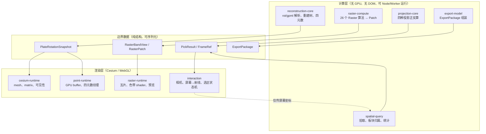

# Unity 计算层剥离与 Cesium 渲染层协作：能力边界报告

盘点日期：2026-07-30
盘点对象：`DPlanet/Unity`（882 个业务脚本 + 963 个 plugin 脚本，`Assets/` 下约 1.9 GB）
参照对象：`packages/*` 现有 Web runtime 实现

## 0. 一页结论

Unity 侧值得剥离的计算能力**不在** `PlanetMath`（1021 行，且强依赖 `UnityEngine.Quaternion`/float 精度，Web 侧 `reconstruction-core` 已用更严格的语义重写并对齐 pyGPlates 黄金值）。真正的资产是 `Scripts/ProjectWorker/` 里那 **22126 行**，特别是 26 个 `Raster*Service` —— 古地形/古水深编译、均衡补偿、古海岸线、artefact 清除、公式编辑、羽化平滑。这些是领域知识密集、Web 侧完全空白、且几乎不含渲染逻辑的部分。

但它们目前无法直接搬走：**每个 Service 的第一个参数都是 `ProjectLayerWorker`** —— 一个持有 `GameObject RootObject`、`MeshRenderer`、`UnityLayer` 的渲染态对象。计算通过 `RasterValueService.GetPixelNumericValue(worker, band, x, y)` 逐像素回调渲染态取值，再通过 `RasterEditOperationService.TryApplyPixelSetOverride(...)` 把结果写回渲染态。算法本身是纯的，**接线是脏的**。

剥离的关键动作是一次**依赖反转**：把 `(worker, bandIndex)` 换成一个 `RasterBandView`（尺寸 + 取值 + NoData + 仿射变换），把返回值从"已写入渲染态"换成"一份像素补丁"。26 个 Service 的算法主体可以逐个平移，代价可控。

四类场景的边界一句话概括：

| 场景 | 计算层职责 | 渲染层职责 | 边界数据 |
|---|---|---|---|
| 看图 | 解重建树，出每板块四元数；选帧 | 上传四元数纹理，画 mesh/瓦片 | `PlateId → Quaternion`、`FrameRef` |
| 看数据 | 空间/时间求解命中的 row ID；统计 | 拾取射线，高亮，弹属性面板 | `rowId`、`pixelXY`、统计结构 |
| 改图 | 像素域算法，产出补丁 | 补丁贴到 GPU 纹理做预览 | `PixelPatch` |
| 导出 | 重算权威古坐标 | 不参与 | `ExportPackage` |

**"导出"是当前最严重的错位**：`DataExportAssistant` 从 `tableWorker.Visual.VisualCtrl._plateElementList` 读古坐标 —— 导出结果依赖渲染层内部状态。渲染没跑到，导出就没数据。这条必须切断。

---

## 1. 现状：Unity 侧的实际分层

### 1.1 名义分层与真实分层

Unity 工程已有 asmdef 级别的划分，但名字和内容不符：

| Assembly | 名义职责 | 实际内容 | 行数 |
|---|---|---|---|
| `PlanetMath` | 球面数学 | 9 个文件，球面旋转/插值/剖分/拾取。**引用 `UnityEngine`，全 float** | 1021 |
| `PlanetGeometry` | 几何生成 | mesh 生成器 + NetTopologySuite 转换层。**依赖 `UnityBase`/`UnityEx`** | ~1500 |
| `PlanetRender` | 渲染 | 只有 1 个文件 `PlanetProjectionRTCamera.cs` | ~200 |
| `Scripts/Planet` | 板块运行时 | 重建树、板块实体、投影视口、查询 | 15005 |
| `Scripts/ProjectWorker` | 项目图层 | **图层运行时 + 26 个 Raster 算法 Service** | 22126 |

所以"计算层已经拆好了"是假象。`PlanetRender` 几乎是空的，真正的渲染逻辑散在 `Scripts/Planet` 和 `Scripts/ProjectWorker` 里，而真正的计算资产也在同样的位置。

### 1.2 三种耦合模式

**模式 A：计算结果只存在于渲染对象里。**
`BoneEntity` 同时是重建树节点和 `GameObject` 持有者：

```csharp
public class BoneEntity {
    public readonly GameObject VisualObject;   // 渲染
    public SphereRotation Rotation;            // 计算结果
    public Quaternion Rotation3D;              // 计算结果（Unity 型）
    public void UpdateInherit(float time, ...) {
        ...
        VisualObject.SetActive(Active);         // 计算过程里改渲染态
    }
}
```

`UpdateInherit` 做的是"按时间选帧 + 重挂父子关系"（纯计算），但顺手 `SetActive`。要拿到 t Ma 的旋转，必须先有 `GameObject`。

**模式 B：算法通过渲染态回调取数据。**
`RasterFormulaEditService.ApplyFormula(worker, bandIndex, pixelList, formulaText, ...)` 内部：

```csharp
double oldValue = RasterValueService.GetPixelNumericValue(worker, bandIndex, pixel.x, pixel.y);
double newValue = expression(oldValue);
...
RasterEditOperationService.TryApplyPixelSetOverride(worker, bandIndex, targetPixelList, valueList, displayAlphaList, ...);
```

表达式编译器（`RasterFormulaEvaluator`，含完整 Parser/AST）是完全独立的好代码；`double → double` 的映射也是纯的。脏的只有取值和回写两端。

**模式 C：导出反向依赖渲染。**
已在结论中说明，见 §5。

### 1.3 一个精度问题

`PlanetMath` 全部使用 `float`（`SphereRotation.Angle`、`SpherePosition`）。深时重建跨 1100 Ma、多级父子板块四元数复合，float 累积误差在长旋转链上不可忽略。Web 侧 `reconstruction-core` 已按 GPlates 语义用 double 重写并通过 pyGPlates 黄金值验证。

**这意味着 `PlanetMath` 不应作为剥离目标** —— 它的等价物已经存在且质量更高。剥离的价值在 `ProjectWorker` 的领域算法。

---

## 2. 核心判据

区分计算与渲染，用三条可判定的标准，而不是"感觉像算法"：

1. **可否在无 GPU、无窗口的进程里跑通并得到相同结果？** 能 → 计算。
2. **输出是否为数值/拓扑/标识符，而非像素、mesh、draw call？** 是 → 计算。
3. **同一输入是否必须得到同一输出（可复现、可回归）？** 是 → 计算。

反过来，渲染层的标志：涉及屏幕分辨率、相机、LOD、帧率、GPU 资源生命周期，或者结果允许在视觉可接受范围内近似。

**灰区判定原则**：几何"细分"归计算（测地线插值步长由数据精度决定，可复现），但"按相机距离选 LOD"归渲染（依赖视点）。色带"值→归一化位置"归计算，"归一化位置→RGBA"归渲染（可 shader 化）。

---

## 3. 四类场景的能力归属

### 3.1 看图（Viewing）

浏览球面/投影视图，拖时间轴看板块运动。

| 能力 | 归属 | 依据 | Unity 现址 | Web 现状 |
|---|---|---|---|---|
| `.rot` 解析、`999` 禁用样本 | 计算 | 纯解析 | `BoneManager._CommitFrame` | 已实现 |
| 欧拉极 → 四元数、最短路径 SLERP | 计算 | 纯数值 | `SphereMath.Lerp` | 已实现（double） |
| 按时间选帧 + 父子关系重挂 | 计算 | 拓扑求解 | `BoneEntity.UpdateInherit`（混入 `SetActive`） | 已实现 |
| 重建树复合（`parent × relative`） | 计算 | 纯数值 | `BoneEntity.UpdateGeo` | 已实现 |
| ViewRoot（锚定板块切换） | 计算 | 旋转代数 | `PlateModel.UpdateViewRoot` | **缺** |
| GPML 解析、有效时间 | 计算 | 纯解析 | GPML loader | 已实现 |
| 球面测地线细分 + 三角剖分 | 计算 | 由数据精度定，可复现 | `TriangulationAssistant`（ear clipping） | 已实现（Cesium） |
| 投影正反算（Mercator/Mollweide/Robinson） | 计算 | 纯数值，含 Newton 迭代与 Robinson 查表 | `PlanetProjectionViewportService`（埋在 5524 行里） | **缺** |
| 图集帧选择（含"最近帧"回退） | 计算 | 时间区间求解 | `ProjectLayerTimeSequenceAtlasWorker` | 部分（`atlas-frame-resolver`） |
| 色带 值→归一化位置 | 计算 | 纯映射 | `ColorRampWorker` | 部分 |
| 归一化位置→RGBA | 渲染 | 可 shader 化 | — | 已 shader 化 |
| mesh 缓存与复用 | 渲染 | GPU 资源 | `PlateAreaSphereMeshCache` | 已实现 |
| 四元数纹理上传、`modelMatrix` 更新 | 渲染 | GPU | `PlateAreaSphereMeshRenderer` | 已实现 |
| LOD、相机、帧调度 | 渲染 | 依赖视点 | `PlateElementInterface.UpdateLOD` | 部分 |

**投影正反算是本场景最值得剥离的一块。** 它是纯函数（`(lonRad, latRad) → Vector2` 及其逆），Web 侧完全没有，而且 2D 制图（§5）也要用同一套。目前它被埋在一个 5524 行、同时管选区状态机和 RT 相机的文件里。

**看图场景的核心边界很窄**：计算层每帧只需交出 `Map<PlateId, Quaternion>` + 可见性掩码，渲染层负责把它变成纹理和矩阵。点数不影响这个边界的大小 —— 这正是 Web 侧 5M 点单 draw call 路径成立的原因。

### 3.2 看数据（Inspecting）

点选要素查属性、identify 栅格像素值、看统计。

| 能力 | 归属 | 依据 | Unity 现址 |
|---|---|---|---|
| 球面射线求交 | 计算 | 解析几何 | `SphereMath.PickSphere` |
| 屏幕坐标 → 射线 | 渲染 | 依赖相机 | `PlanetProjectionViewportService` |
| 命中要素判定（角距阈值） | 计算 | 空间查询 | `TryPickRuntimeRecord` |
| 经纬度 → 像素索引 | 计算 | 仿射变换 | `RasterMath.SpherePosToRasterPos` |
| 像素取值（含 overlay 合成） | 计算 | 数值查询 | `RasterValueService.GetCompositedPixelNumericValue` |
| 板块归属查询 | 计算 | 点在多边形内 | `PlateLogicQueryService` |
| 选区像素统计（min/max/mean/count） | 计算 | 纯聚合 | `RasterEditStatisticsService.AnalyzePixels` |
| IDW 邻域插值采样 | 计算 | 纯数值 | `RasterNeighborhoodInterpolationService.SampleIDW` |
| 高亮几何生成 | 渲染 | mesh | `AppendRuntimeSelectionHighlight` |
| 属性面板、格式化 | 渲染/UI | 展示 | `PlatePropertyPresentationService` |

**边界应落在标识符上**：计算层返回 `rowId` / `(pixelX, pixelY)` / `plateId`，不返回属性内容。属性按 ID 二次请求 —— Web 侧阶段 2 已经是这个模式，Unity 侧 `PlateLogicQueryResult` 则把 `Color32 RawColor`、`PlateAreaEntity?`、`PlateEntity?` 一起返回，混入了渲染态引用。

`PlateLogicQueryService` 用的是"颜色编码 cube atlas 查表"（`CubeAtlasQueryInfo`、`RawColor`、`LookupToken`）—— 即把板块归属烘进纹理，靠采样颜色反查 ID。这是 GPU 技巧，不是可移植算法。Web 侧应改用真正的空间索引（R-tree / 点在多边形内），这块**重写而非移植**。

### 3.3 改图（Editing）

栅格编辑，即古地形/古水深重建工作流。**这是剥离价值最高的场景。**

26 个 `Raster*Service` 按性质分三层：

**第一层：纯像素算法（直接可移植，只需换掉取值/回写两端）**

| Service | 行数 | 能力 |
|---|---:|---|
| `RasterFormulaEditService` | 479 | 表达式编译（含 Parser/AST）+ 逐像素求值 |
| `RasterLinearRescaleService` | 168 | 线性重缩放 |
| `RasterArtefactRemovalService` | 296 | 规则编译 + artefact 识别清除 |
| `RasterFillGapsService` | 195 | 空洞填充 |
| `RasterEditSmoothService` | — | 平滑 |
| `RasterBrushEditService` | 281 | 笔刷覆写（含软边） |
| `RasterEditValueFilterService` | — | 值域过滤 |
| `RasterEditStatisticsService` | — | 选区统计 |
| `RasterNeighborhoodInterpolationService` | — | IDW |

**第二层：领域算法（地质语义，最高价值，Web 完全空白）**

| Service | 行数 | 能力 |
|---|---:|---|
| `RasterTopoBathymetryCompileService` | 344 | 地形/水深编译 |
| `RasterTopoBathymetryCreateService` | 392 | 地形/水深创建 |
| `RasterIsostaticCompensationService` | 207 | 均衡补偿 |
| `RasterBathymetryCalculationService` | 187 | 水深计算 |
| `RasterPaleoshorelineService` | — | 古海岸线设定 |
| `RasterSeaLevelEditService` | — | 海平面调整 |
| `RasterBoundaryFeatherSmoothService` | 727 | 边界羽化平滑 |
| `RasterRegionBlendService` | 358 | 区域自然融合（含 anchor profile） |

**第三层：与选区/渲染耦合（需重新设计）**

| Service | 行数 | 耦合点 |
|---|---:|---|
| `RasterSelectionService` | 360 | 生成像素列表（算法纯），但输入是 `ProjectionRasterRegionSelectionState`（UI 状态机） |
| `RasterCopyPasteService` | 333 | 剪贴板 + `RasterCompilationOverlayRegionSnapshot` |
| `RasterEditOperationService` | — | **回写渲染态，是需要被替换的那一端** |
| `RasterLocalCacheMetadata(+Service)` | 1993 | 本地缓存/指纹，属基础设施 |

归属判定：

| 能力 | 归属 | 依据 |
|---|---|---|
| 上述第一、二层全部算法 | 计算 | 无 GPU 可跑，结果可复现，输出是数值 |
| 选区几何 → 像素列表 | 计算 | 光栅化多边形，纯几何 |
| 选区交互状态机（顶点增删、anchor 拖动、圆角预览） | 渲染/UI | 依赖屏幕坐标与相机 |
| 编辑结果预览 | 渲染 | 补丁贴 GPU 纹理 |
| Undo/Redo 栈 | 计算 | 补丁的逆即可复原，与渲染无关 |
| 编辑产物固化（COG/瓦片） | 计算（服务端） | 长耗时，不应在浏览器 |

**必要的依赖反转。** 现状：

```csharp
// 输入是渲染态，输出写进渲染态
RasterFormulaEditApplyResult ApplyFormula(
    ProjectLayerWorker worker, int bandIndex, List<Vector2Int> pixelList, ...)
```

目标：

```ts
// 输入是数据视图，输出是补丁
function applyFormula(
  band: RasterBandView,        // { sizeX, sizeY, getValue(x,y), noData, transform }
  pixels: PixelIndex[],
  formula: string,
  filter?: ValueFilter,
): RasterPatch                 // { pixels, newValues, oldValues, stats, warnings }
```

`RasterPatch` 同时服务三个消费者：渲染层做即时预览、Undo 栈做回退、服务端做固化。这个类型是"改图"场景的枢纽。

### 3.4 导出结果（Exporting）

出图、出数据、进 2D 制图。

**当前实现的问题**，`DataExportAssistant.CollectPointLayerData`：

```csharp
var plateElements = tableWorker.Visual.VisualCtrl._plateElementList;
foreach (var element in plateElements) {
    PaleoLongitude = element.CurrentPosition.LongitudeDegree,   // 从渲染态读
    PaleoLatitude  = element.CurrentPosition.LatitudeDegree,
}
```

三个后果：导出前必须先渲染；被 LOD/可见性剔除的点可能缺失（`_plateElementList` 受 `RenderActive`、`LODChildList` 影响）；float 精度（渲染够用，导出不够）。此外访问的是下划线开头的字段 —— 连封装都没有。

归属判定：

| 能力 | 归属 | 依据 |
|---|---|---|
| 权威古坐标重算 | 计算 | 必须由重建内核直接算，不读渲染态 |
| 属性表拼装 | 计算 | 纯数据 |
| 时间/模型版本/输入哈希写入 | 计算 | 可复现性要求 |
| 投影后 2D 坐标 | 计算 | 与 §3.1 同一套正算 |
| 图集帧 → 底图引用 | 计算 | 帧选择 + URL 解析 |
| 截图 / 出图 | 渲染 | 屏幕产物 |
| 高分辨率、长耗时导出 | 计算（服务端） | 浏览器不适合 |
| 图例、比例尺、注记排版 | 渲染 | 视觉 |

**边界**：导出层只接受 `ExportPackage`（一个纯数据结构），由计算层从数据源 + 时间 + 模型版本直接产出。渲染层不参与，除了截图这一种确实需要屏幕产物的情况。

现有 `ExportDataPackage` 结构本身是合理的（`CurrentAge` / `PlateModelId` / `Layers[].Points[]` / `Basemaps[]`），问题只在数据来源。可以保留结构、换掉填充路径 —— 这也让 `ExportDataController` 的短期兼容路径可以平滑过渡。

---

## 4. 目标组件划分



### 4.1 计算层组件契约

**`reconstruction-core`**（Web 已有，需补 ViewRoot）

- 输入：`.rot` 文本、`.gpml` 文本、`timeMa`、`anchorPlateId`、可选 `viewRootPlateId`
- 输出：`Map<PlateId, Quaternion>`、`Map<PlateId, {validFrom, validTo}>`、多边形环坐标
- 边界：不知道 Cesium，不持有 GPU 资源，不知道"可见"
- 验收：对 pyGPlates 黄金坐标，0 Ma 与多个非零年龄一致

**`projection-core`**（新建，从 `PlanetProjectionViewportService` 抽取）

- 输入：`(longitudeRad, latitudeRad, projectionType)`；逆向为 `(normalizedX, normalizedY, projectionType)`
- 输出：`Vector2` / `(lonRad, latRad, ok)`
- 边界：纯函数，无状态。不知道画布尺寸 —— 输出归一化坐标，由渲染层缩放
- 注意：Robinson 用 5° 查表 + 线性插值，Mollweide 用 Newton 迭代（8 次上限，1e-4 容差）。这些常量需连同代码一起迁移，否则结果不一致
- 验收：与 proj4 在采样网格上比对；正反算往返误差 < 1e-6

**`raster-compute`**（新建，从 `ProjectWorker` 抽取，工作量最大）

- 输入：`RasterBandView`（尺寸、`getValue(x,y)`、NoData、仿射变换）+ 像素列表 + 算法参数
- 输出：`RasterPatch`（像素索引、新值、旧值、统计、警告）
- 边界：不写回任何渲染态；不知道 overlay 如何合成到纹理；不知道 Undo 栈如何管理
- 迁移顺序建议：先 `formula` / `linearRescale` / `statistics`（验证 `RasterBandView` 抽象是否够用），再领域算法（`topoBathymetry` / `isostatic` / `paleoshoreline`），最后选区相关
- 验收：同一 `RasterBandView` + 同一参数，Unity 与 Web 输出逐像素一致（需先在 Unity 侧加一层适配器暴露同一接口，才能做对比测试）

**`spatial-query`**（新建，部分重写）

- 输入：射线或球面位置 + 数据集引用 + `timeMa` + 角距阈值
- 输出：`rowId` / `(pixelX, pixelY)` / `plateId`，**不含属性内容、不含颜色**
- 边界：不做屏幕坐标转换（渲染层传入射线）；不返回渲染对象引用
- 注意：Unity 的颜色编码 cube atlas 查表方案不移植，改用空间索引

**`export-model`**（新建）

- 输入：项目文档 + `timeMa` + 数据源引用 + 模型版本
- 输出：`ExportPackage`
- 边界：**绝不读渲染层**。古坐标由 `reconstruction-core` 现算
- 验收：不启动 Cesium 也能产出完整包；与渲染视图在相同时间点的坐标一致

### 4.2 渲染层组件契约

| 组件 | 输入 | 输出 | 不得做 |
|---|---|---|---|
| `cesium-runtime` | 多边形环 + 旋转快照 | primitive、`modelMatrix` | 解析文件、算旋转 |
| `point-runtime` | WGP 二进制 + 旋转快照 + 样式 | GPU buffer、draw call | 逐点在 JS 改坐标 |
| `raster-runtime` | 瓦片/帧 + `RasterPatch` + 色带 | 纹理、预览 | 执行像素算法 |
| `interaction` | 鼠标事件、相机 | 射线、屏幕坐标、选区状态 | 判定命中要素 |

### 4.3 边界原则

1. **边界数据必须可序列化。** 传 `Map<PlateId, Quaternion>`、`RasterPatch`、`rowId`，不传 `GameObject`、`MeshRenderer`、`PlateEntity`。这条自动排除模式 A/B/C 三种耦合。
2. **计算层不认识渲染层的类型。** 依赖方向单向：渲染 → 边界 ← 计算。
3. **边界大小与数据量解耦。** 500 万点，边界仍只是几百个板块的四元数。
4. **计算层可在 Worker 里跑。** 这是"不许摸 DOM/GPU"的天然强制手段，也顺带解决主线程长任务。
5. **同一算法只有一份实现。** 服务端固化和浏览器预览调用同一份 `raster-compute`；3D 与 2D 共用同一份 `projection-core`。

---

## 5. 已识别的具体问题

按影响排序：

**1. 导出依赖渲染态（高）**
`DataExportAssistant` 读 `Visual.VisualCtrl._plateElementList`。导出正确性受 LOD 和可见性影响。修法：`export-model` 从重建内核现算，不读渲染。

**2. 领域算法与图层运行时纠缠（高）**
26 个 Service 全部以 `ProjectLayerWorker` 为第一参数。这是唯一阻止直接移植的结构性障碍，也是本次剥离的主要工作量。修法：引入 `RasterBandView` / `RasterPatch`，依赖反转。

**3. 投影正反算埋在 5524 行文件里（中）**
`PlanetProjectionViewportService` 同时管投影数学、选区状态机、RT 相机、快照缓存（6 个 Dictionary）。纯数学部分（约 300 行，含 Robinson 查表与 Mollweide 迭代）应独立成包，3D/2D 共用。

**4. 板块归属查询用颜色编码查表（中）**
`PlateLogicQueryService` 的 `CubeAtlasQueryInfo` / `RawColor` / `LookupToken` 是 GPU 技巧。Web 侧应重写为空间索引，不移植。

**5. `PlanetMath` 全 float（中）**
深时长旋转链上误差累积。Web 侧 `reconstruction-core` 已用 double 重写并对齐黄金值，故 `PlanetMath` 不作为剥离目标。

**6. 计算过程内改渲染态（中）**
`BoneEntity.UpdateInherit` 在选帧时 `VisualObject.SetActive(Active)`。剥离后应输出可见性掩码，由渲染层决定如何应用。

**7. 调试代码残留（低）**
`TriangulationAssistant` 里有 `static bool ssss = false` 和硬编码 `D:\output\radians` 写文件路径。迁移时清掉。

---

## 6. 实施顺序

按"先验证抽象、后搬运资产"排列，每步都可独立验收：

1. **`projection-core`** —— 最小、最纯、无依赖、2D/3D 双向受益。用来验证"抽一个纯计算包"的流程。
2. **`export-model`** —— 切断最严重的错位。依赖已有的 `reconstruction-core`，不需要新抽象。
3. **`RasterBandView` / `RasterPatch` 类型定义 + 3 个试点算法**（formula、linearRescale、statistics）—— 验证抽象是否够用。**这一步的结论决定后续 23 个 Service 的迁移成本，不要跳过。**
4. **领域算法批量迁移** —— topoBathymetry、isostatic、paleoshoreline、bathymetry、seaLevel、boundaryFeather、regionBlend。价值最高，但必须等第 3 步的抽象定型。
5. **`spatial-query` 重写** —— 空间索引替代颜色查表。
6. **选区与 Undo** —— 依赖 `RasterPatch` 定型。

第 3 步是整个计划的风险集中点。建议在此之前先在 Unity 侧加一层适配器，让 `RasterBandView` 能包装现有 `ProjectLayerWorker`，这样同一算法可以在两边跑同一组输入做逐像素对比 —— 否则 22126 行代码的迁移正确性没有验证手段。

---

## 7. 质量门槛

每个计算包必须满足：

- **可无头运行**：Node/Worker 里跑通，无 GPU、无 DOM、无 Cesium
- **可复现**：同输入同输出，可回归；随机/迭代算法固定种子与容差
- **可对比**：与 Unity 现实现在同一输入上逐值比对（需先加适配器）
- **精度声明**：float/double 的选择要显式，深时长链默认 double
- **无反向依赖**：静态检查计算包不 import 渲染包

补充两条来自现有基线的约束：

- 科学模式与性能模式的区分（`validityPolicy`、`unassignedPointPolicy`）属于**数据契约**，不属于计算或渲染任何一层。计算层读取它，不定义它。
- 当前范围只支持刚性板块重建。拓扑网络变形、half-stage 海岭重建、速度场是独立能力，不能在剥离过程中被顺手塞进 `reconstruction-core` 伪装成刚性重建的一部分。
