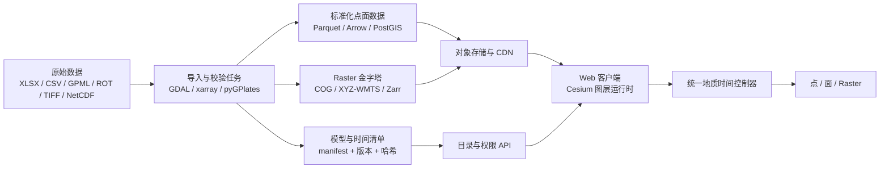

# TimeMachineWeb 长期目标可行性与目标架构

> **UI 唯一真实参考**：产品界面与交互实现以
> [`docs/ui-reference/canonical/index.html`](ui-reference/canonical/index.html)
> 为唯一规范。本文讨论架构和能力边界，不覆盖或替代该 UI 基线。

## 1. 结论

| 目标 | 可行性 | 建议 |
|---|---|---|
| 可复用的板块运动与深时数据可视化组件 | 高 | 先从当前 Demo 中抽出无 UI 的重建内核，再提供 Cesium 图层适配器和可选时间轴。组件不能把数据格式、文件 URL 或 Cesium `Viewer` 写死。 |
| 支持点、面和 Raster 的完整前后端产品 | 高，但必须分层建设 | 浏览器负责交互和可见数据渲染；XLSX/GPML/NetCDF/GeoTIFF 的清洗、板块归属、切片和索引应在服务端或离线任务中完成。 |

当前 Demo 已经验证了最关键的科学计算链路：PLATES 旋转解析、最短路径
SLERP、重建树、Hamilton 四元数复合、球面三角剖分以及按时间更新板块矩阵。
因此长期项目的主要风险已从“算法能否在 Web 端复现”转为“数据契约、超大数据
组织、GPU 批处理和 Raster 产品化”。

## 2. 现有真实数据带来的约束

本次只读盘点 `data/` 得到：

| 数据 | 实际情况 | 架构含义 |
|---|---|---|
| 板块模型 | `data/PlateModelData` 约 5.2 MB；471 个 GPML 要素、503 个多边形、241 个 Plate ID；当前剖分约 649,905 个三角面 | 可在浏览器加载；网格应缓存，时间变化只更新每个板块的旋转矩阵。 |
| 点数据 | `pbdb_data.xlsx` 约 31 MB；275,347 条数据、25 个主要字段；275,346 条有完整经纬度 | 已足以作为第一阶段真实性能基线，但 XLSX 不应成为线上传输格式。 |
| 点数据质量 | 没有 `plate_id`；存在 `lng`、`lat`、`max_ma`、`min_ma`；275,312 条同时具有两个年龄字段，其中 21 条 `min_ma > max_ma` 且疑似被 Excel 日期化 | 导入阶段必须做板块归属和年龄校验；无 Plate ID 就无法正确做刚性重建。 |
| 单幅 Raster | 共约 44 MB；包含 361×180 与 3601×1801 的 Float32/Float64 网格、3600×1800 图片；部分文件有经纬度仿射变换，部分没有 | 必须在导入阶段统一坐标参考、NoData、色带和地理范围，不能仅凭文件扩展名渲染。 |
| 时间序列图集 | 共约 1.1 GB；Muller 图集 251 张 4839×2420 PNG；PALEOMAP 图集 90 张 3600×1800 JPG；Scotese 图集约 987 MB | 不能整体进入 Vite `publicDir` 或首屏加载；应生成时间清单、缩略图和空间瓦片。 |

### 点坐标必须先定义语义

每个可重建点至少需要：

```ts
interface ReconstructablePoint {
  id: number;
  longitudeDeg: number;
  latitudeDeg: number;
  plateId: number;
  validFromMa: number; // 较老边界，例如 max_ma
  validToMa: number;   // 较年轻边界，例如 min_ma
  coordinateTimeMa: number; // 坐标属于哪个时间，通常为 0
}
```

若坐标是现今坐标，显示 `t Ma` 时使用板块相对锚定板块的总旋转
`q(t) · p(0)`。若坐标本身已经位于某个古地理时间，不能再次按现今坐标处理；
必须记录 `coordinateTimeMa`，并计算该时间到目标时间的相对有限旋转。时间可见性
使用 GPlates 顺序：

```text
validFromMa >= timeMa >= validToMa
```

PBDB 点表当前没有 Plate ID。建议在离线导入阶段使用板块多边形做空间分区，并用
pyGPlates 的 plate partitioning 结果建立黄金样本。pyGPlates 官方 API 同时提供
重建树、有限旋转、板块分区和常规要素重建，可作为服务端处理与正确性基准：
[pyGPlates API reference](https://www.gplates.org/docs/pygplates/pygplates_reference)。

## 3. 目标一：组件化产品

### 3.1 推荐的包边界

```text
@webgplates/core
  四元数、旋转序列、重建树、时间有效性；不依赖 DOM 和 Cesium

@webgplates/io
  ROT/GPML/Arrow/manifest 解析、Web Worker 协议、数据源接口

@webgplates/cesium
  PlateLayer、PointLayer、PolygonLayer、RasterLayer、拾取和 GPU 资源生命周期

@webgplates/ui
  可选地质时间轴、图层面板、状态和事件绑定
```

组件应支持两种用法：

1. 只使用 `@webgplates/core` 做坐标计算或服务端校验；
2. 将已有的 Cesium `Viewer` 注入 `@webgplates/cesium`，避免组件偷偷创建全局
   Viewer、Token 或网络连接。

建议的外部 API：

```ts
const atlas = await createTimeMachineWeb({
  viewer,
  rotationModel: { url: "/models/paleomap.rot" },
  platePolygons: { url: "/models/paleomap.gpml" },
});

const fossils = await atlas.layers.addPointLayer({
  source: { type: "arrow", url: "/datasets/pbdb/points.arrow" },
  columns: {
    longitude: "lng",
    latitude: "lat",
    plateId: "plate_id",
    validFromMa: "max_ma",
    validToMa: "min_ma",
  },
});

atlas.time.set(100);
atlas.events.on("timechange", ({ timeMa }) => {});
atlas.destroy();
```

### 3.2 点渲染的正确扩展路径

不能在每次拖动时间轴时遍历 27 万或 100 万个点并在 JavaScript 中改写坐标。
正确的计算规模应由点数 `N` 降到活动板块数 `P`：

1. 导入时将点转换为球面单位向量和紧凑 TypedArray；
2. 每个时间点只计算约 241 个板块四元数；
3. 第一阶段按 Plate ID 分组，每组共享 Cesium `modelMatrix`；
4. 数据更大时，把 `plateIndex` 作为顶点属性，在一个或少量 draw call 中通过
   GPU 查找对应四元数并旋转；
5. 拾取只回传整数 ID，完整属性在列式表中按需读取。

Cesium 官方建议将大量点组织为“少量集合、每个集合包含很多点”，并指出频繁
增删会触发顶点缓冲区的 O(n) 重写：
[PointPrimitiveCollection performance notes](https://cesium.com/learn/cesiumjs/ref-doc/PointPrimitiveCollection.html)。
Cesium 1.143 还提供基于 ArrayBuffer 的 `BufferPointCollection`，但其官方文档
明确标为 experimental；可用于性能分支验证，公共组件 API 不能直接依赖其稳定性：
[BufferPrimitiveCollection](https://cesium.com/learn/cesiumjs/ref-doc/BufferPrimitiveCollection.html)。

建议按基准测试选择实现，而不是预先写死阈值：

| 规模 | 候选实现 |
|---|---|
| 小到中等点集 | `PointPrimitiveCollection`，按更新频率和 Plate ID 合理分组 |
| 数十万至百万点 | `BufferPointCollection` 实验分支，或自定义 Cesium Primitive |
| 数百万且全局分布 | 服务端空间 LOD/瓦片 + 可见瓦片 GPU buffer；不可一次常驻全部属性 |

数据传输使用 Arrow IPC 或等价的列式二进制格式，不在浏览器解析 XLSX。Apache
Arrow JS 可直接从 `fetch()` 读取 IPC，并能从 TypedArray 建立无额外复制的向量：
[Apache Arrow JavaScript](https://arrow.apache.org/js/current/)。

### 3.3 组件验收标准

- 相同输入、锚定板块和时间得到与 pyGPlates 黄金值一致的坐标；
- 数据 URL、Viewer、时间轴和图层样式均可注入；
- 点、面、Raster 图层共享同一个 `timeMa` 状态；
- 时间拖动不按点数重新分配 JavaScript 对象；
- 所有 Worker、事件、Cesium Primitive 和 GPU 资源都能由 `destroy()` 释放；
- 核心包可在 Node 和浏览器中运行，渲染包才依赖 Cesium。

## 4. 目标二：完整前后端产品

### 4.1 推荐架构



### 4.2 服务端职责

- **导入任务**：格式识别、字段映射、经纬度/年龄校验、Plate ID 分配、模型版本
  绑定、空间索引和统计；
- **数据目录 API**：数据集、模型、时间范围、字段、样式、许可和处理状态；
- **对象存储/CDN**：Arrow/Parquet、网格、Raster 瓦片和 manifest；
- **查询 API**：属性过滤、空间窗口、时间过滤以及下载，不承担逐帧点旋转；
- **异步任务**：Raster 重投影/切片、点板块分区、简化层级和预计算；
- **科学基准**：用 pyGPlates 对抽样点、板块边界和关键时间生成可追溯黄金结果。

首版后端可以采用 Python（FastAPI、GDAL、xarray、pyGPlates）完成科学数据导入，
PostgreSQL/PostGIS 保存目录和可查询要素，对象存储保存大文件；只有基准测试证实
热点后，再将特定服务改为 Rust/Go。

### 4.3 Raster 策略

1. **静态全球图片**：先确认其 2:1 图片是否真的是经纬度等距投影，再切成
   256/512 像素瓦片；
2. **有地理参考的标量网格**：保留原始值与 NoData，生成 COG 或服务端瓦片，
   色带作为独立样式；COG 通过内部瓦片、overview 和 HTTP Range 只读取所需区域：
   [OGC Cloud Optimized GeoTIFF](https://www.ogc.org/standards/ogc-cloud-optimized-geotiff/)；
3. **时间序列**：使用 `/tiles/{layer}/{time}/{z}/{x}/{y}` 和 manifest 映射实际
   时间，不从文件名临时猜时间；
4. **科学分析网格**：需要数值查询时保留 NetCDF/Zarr 服务端数据，浏览器只接收
   可见瓦片或抽样结果；
5. **随板块运动的 Raster**：普通 Cesium `ImageryProvider` 只负责椭球表面瓦片，
   不能自动解决跨板块变形。优先在服务端按目标时间预重投影；若必须连续时间，
   需按 Plate ID 切分栅格并用网格纹理在 GPU 上变换。

Cesium 的 `ImageryProvider` 本身就是按瓦片请求、级别和范围组织的接口，适合实现
时间感知的自定义 provider：
[Cesium ImageryProvider](https://cesium.com/learn/cesiumjs/ref-doc/ImageryProvider.html)。

### 4.4 产品化必须保留的正确性元数据

每个数据集需要绑定：

- `modelId` 与精确版本/哈希；
- `anchorPlateId`；
- `coordinateTimeMa`；
- `plateAssignmentMethod` 与 Plate ID 字段；
- `validFromMa` / `validToMa` 的闭区间语义；
- 坐标系、球半径/椭球、Raster geotransform、NoData 和色带；
- 原始文件哈希、处理流水线版本和失败行报告。

同一层不能悄悄切换板块模型；模型、数据和黄金校验必须作为一个可复现版本发布。

## 5. 关键风险与处理

| 风险 | 处理 |
|---|---|
| 浏览器端按点逐帧计算导致卡顿 | 板块级矩阵或 GPU 四元数查找，点坐标 buffer 保持不变。 |
| 27 万条 XLSX 在主线程解析 | 离线转 Arrow/Parquet；浏览器 Worker 只解码需要的列。 |
| 没有 Plate ID 导致错误重建 | 导入阶段做 plate partitioning，并抽样与 pyGPlates 对照。 |
| Raster 无 CRS/geotransform | 导入失败而不是猜测；由用户确认地理范围后再入库。 |
| 1.1 GB 图集被打包或整包下载 | 对象存储 + manifest + 瓦片 + 邻近时间预取。 |
| Cesium experimental API 变化 | 在内部渲染适配层隔离；公共 API 只暴露稳定的 Layer 接口。 |
| 直接复制 GPlates GPL 代码带来许可义务 | 核心数学实现保持可追溯、测试驱动的独立实现；任何直接复用在发布前做 GPL v2 合规审查。 |

## 6. 建议实施顺序

1. 固化点/面/Raster 数据契约、数据质量报告和性能基线；
2. 抽出 `@webgplates/core`，保持现有 38 个测试与 pyGPlates 黄金值；
3. 完成 275,347 个 PBDB 点的离线 Plate ID 分配和 Arrow 转换；
4. 实现 `PointLayer` 的板块级矩阵版本，并与 GPU 批处理版本做 A/B 测试；
5. 发布框架无关的组件 MVP；
6. 再建设目录 API、对象存储、异步导入和 Raster 瓦片；
7. 最后增加权限、项目管理、分享、任务审计和多租户能力。

组件和完整产品应共享同一套 core、数据契约和图层接口。这样组件不是产品的临时
分支，而是产品客户端的渲染内核。
