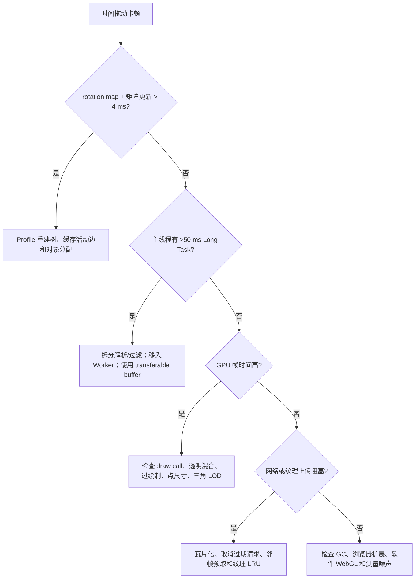

# TimeMachineWeb 性能测试方案

## 1. 测试目标

本方案要回答四个问题：

1. 点数增加时，瓶颈在网络、解析、JavaScript 对象、CPU 旋转、GPU 上传还是绘制；
2. 时间轴拖动能否保持交互连续，并且计算量只随活动 Plate ID 数增长；
3. 点、面和 Raster 混合时，客户端能否只加载和绘制当前可见数据；
4. 每次优化是否仍保持与 GPlates/pyGPlates 一致的坐标和时间语义。

性能通过不能替代正确性通过。任何被测实现必须先通过现有四元数、重建树、GPML
和 pyGPlates 黄金测试。

## 2. 已确认的真实基线

### 2.1 数据集

| 编号 | 来源 | 规模 | 用途 |
|---|---|---|---|
| `PLATE-503` | `data/PlateModelData` | 471 要素、503 多边形、241 Plate ID、约 649,905 三角面 | 面渲染和时间轴固定基线 |
| `PBDB-REAL` | `data/PointData/pbdb_data.xlsx` | 275,347 条；清洗后 275,291 条；275,272 条已分配 Plate ID | 真实点分布和属性基线 |
| `GRID-SMALL` | `000_tas_scotese02a_v21321.nc` | 361×180 Float32 | 小 Raster 与解码基线 |
| `GRID-GLOBAL` | `Merdith2021_SEAFLOOR_AGE_grid_0.0Ma.nc` | 3601×1801 Float64，0.1° 经纬度网格 | 全球数值 Raster 基线 |
| `IMAGE-PALEO` | PALEOMAP JPG | 3600×1800；序列共 90 张 | 图片时间序列和瓦片切换 |
| `IMAGE-MULLER` | Muller PNG | 4839×2420；连续 0–250 共 251 张 | 较高分辨率时间序列 |
| `ATLAS-MIXED` | `data/TimeSequenceAtlas` | 总计约 1.1 GB | 验证不整包加载和长期缓存 |

`PBDB-REAL` 在正式制备性能夹具前先执行：

- 先保留同时具有坐标和两个年龄字段、且 `max_ma >= min_ma` 的 275,291 条候选
  记录；本轮实际拒绝 36 条缺失记录和 20 条年龄区间无效记录；
- 为点分配 `plate_id`、`coordinate_time_ma` 和模型版本；
- XLSX 离线转为可直接映射 GPU buffer 的 WGP1 定长二进制；
- 生成固定种子、固定哈希的 10k/100k/275k 子集；
- 1M/5M 压力集通过对真实点做确定性循环复用生成，不能伪装成新增
  科学观测。
- 极限性能夹具将全部点设为 `0–1100 Ma` 永久有效；19 条未分配点仅在性能导出
  中挂到锚定板块 0，确保任意时间都提交和 rasterize 全量点。

### 2.2 测试机器

当前可用开发机记录为 Apple M2 Max、38 核 GPU、96 GB 内存。它只能代表
`DEV-HIGH`，不能作为最低发布门槛。

| 档位 | 建议设备 | 目的 |
|---|---|---|
| `DEV-HIGH` | 当前 M2 Max / 96 GB | 快速迭代、Profiler 和 5M 压力测试 |
| `DESKTOP-BASE` | Apple M1 8 GB 或 Windows Iris Xe 16 GB | 组件默认发布门槛 |
| `DESKTOP-MID` | 近五年主流独显、16 GB | 百万点与混合图层目标 |
| `MOBILE-OBSERVE` | 近三年 iPad/iPhone 或 Android | 观察性结果；首版不承诺百万点 |

每次报告记录 OS、浏览器精确版本、GPU renderer、屏幕分辨率、
`devicePixelRatio`、Cesium 版本和构建哈希。

## 3. 被测实现

至少比较以下四条路径：

| 变体 | 描述 | 目的 |
|---|---|---|
| `CPU-PER-POINT` | 时间变化时在 JS 中旋转每个点并写回坐标 | 负面对照，量化不可扩展路径 |
| `PLATE-MATRIX` | 点按 Plate ID 分组，时间变化只更新每组 `modelMatrix` | 组件 MVP 候选 |
| `BUFFER-POINT` | Cesium `BufferPointCollection`，仍按板块或瓦片组织 | 验证 ArrayBuffer 实验 API 收益 |
| `GPU-QUATERNION` | 点带 `plateIndex`，shader 从四元数表查找并旋转；本轮已实现 | 百万点当前基线 |

每个变体必须使用相同点集、样式、相机、可见范围、拾取设置和
`resolutionScale`。不允许通过关闭必要功能制造虚假的性能优势。

## 4. 分层测试

### 4.1 离线数据制备

这部分不计入页面首屏时间，但要单独记录吞吐和失败率：

- XLSX 扫描、字段映射和 WGP1 写出；
- 点到板块的空间分区；
- 年龄/坐标质量校验；
- GPML 三角剖分与多级简化；
- NetCDF/GeoTIFF 坐标确认、COG/XYZ 切片和 overview；
- 时间序列 manifest 生成。

输出一个机器可读 manifest：

```json
{
  "format": {
    "magic": "WGP1",
    "version": 1,
    "headerBytes": 64,
    "recordStrideBytes": 20
  },
  "basePointCount": 275291,
  "maxPlateId": 992,
  "datasets": [
    {"id": "pbdb-275k", "pointCount": 275000, "sha256": "..."}
  ]
}
```

### 4.2 数学与数据微基准

| 编号 | 测试 | 记录 |
|---|---|---|
| `M1` | `.rot` 解析与 `RotationModel` 构建 | 总耗时、分配内存、序列数 |
| `M2` | 0–1100 Ma 共 1,101 个整数时间的 rotation map | p50/p95/p99；每次活动 Plate 数 |
| `M3` | 10k/100k/1M 点 CPU 四元数旋转 | 点/秒、主线程耗时，用作负面对照 |
| `M4` | WGP1 Worker 校验与 transferable buffer 交接 | fetch、校验、拷贝/转移、主线程阻塞 |
| `M5` | 可见时间过滤与属性过滤 | 不同选择率下的耗时 |
| `M6` | GPML 解析和 503 个多边形剖分 | 首次耗时、缓存命中耗时、顶点/索引字节 |

微基准先 warm-up，再运行至少 30 次；报告中位数、p95、p99 和离群值，不只报告
最快一次。

### 4.3 浏览器场景

| 编号 | 场景 | 操作 |
|---|---|---|
| `B0` | 当前板块面基线 | 冷启动，等待 503 多边形就绪；0/100/250/500 Ma 跳转 |
| `B1` | 100k 点 | 加载、旋转地球、缩放、拾取、连续拖动时间轴 20 秒 |
| `B2` | 275k 真实点 | 与 `B1` 相同，作为首版发布门槛 |
| `B3` | 1M 点 | 比较四种渲染变体和空间 LOD |
| `B4` | 5M 点 | 只在 `DEV-HIGH` 验证瓦片/LOD；禁止全量 JS 对象常驻 |
| `B5` | 多边形压力 | 当前网格、2×、5× 三角量；测试相机移动和时间拖动 |
| `B6` | 单幅 Raster | 原图整纹理与 256/512 瓦片对照；冷/热缓存 |
| `B7` | Raster 时间序列 | 0→250 Ma 连续播放、随机跳时、相邻时间预取 |
| `B8` | 混合场景 | `PLATE-503` + `PBDB-REAL` + 1 个 Raster 图层 |
| `B9` | 属性交互 | 拾取、框选、筛选、图层开关和详情查询 |
| `B10` | 稳定性 | 30 分钟播放 + 1,000 次随机跳时 + 500 次相机操作 |
| `B11` | 弱网 | 20 Mbps/80 ms 和 5 Mbps/150 ms；冷缓存与断续恢复 |

`B1–B4` 要分别测试：

- 全局全部点可见；
- 相机视锥和背面剔除；
- 屏幕空间聚合/LOD；
- 关闭拾取与开启拾取；
- 不透明点与半透明点。

## 5. 指标与首轮门槛

门槛针对生产构建，不针对 Vite 开发模式。

### 5.1 交互与帧率

| 指标 | `PBDB-REAL + PLATE-503` 首轮门槛 |
|---|---|
| 时间滑块输入到首个正确画面 | p95 ≤ 100 ms，最大值 ≤ 200 ms |
| 连续拖动/播放帧率 | `DESKTOP-BASE` p50 ≥ 30 FPS；`DESKTOP-MID` 目标 ≥ 60 FPS |
| 单帧间隔 | p95 ≤ 33.3 ms；不出现连续 3 帧都 > 100 ms |
| 拾取到详情显示 | p95 ≤ 100 ms |
| 板块 rotation map + 矩阵更新 | p95 ≤ 4 ms，且不随点数线性增长 |
| 10 秒稳定交互中的 Long Task | >50 ms 的任务 ≤ 1 个；稳态时间拖动期间目标为 0 |

### 5.2 加载、内存和网络

| 指标 | 首轮门槛 |
|---|---|
| 本地冷启动到第一幅可交互画面 | `DESKTOP-BASE` ≤ 5 s |
| 275k 点 Worker 解码后主线程阻塞 | 任一连续阻塞 ≤ 50 ms |
| 275k 点新增 JS heap | ≤ 150 MB |
| 1M 点新增 JS heap | ≤ 600 MB；目标通过列式数据显著低于此值 |
| 30 分钟稳定性测试后的 retained heap | 相对稳定阶段增长 ≤ 10%，且不随每次跳时持续增长 |
| 首屏 Raster 请求 | 只请求当前视图需要的瓦片；禁止下载完整 1.1 GB 图集 |
| 随机跳时 | 取消过期请求；只预取目标时间相邻帧，旧纹理有明确 LRU 上限 |

浏览器无法可靠读取所有 GPU 显存，因此同时记录可计算的 buffer/texture 字节，
并用系统 GPU 工具做观察性记录。不得把 `performance.memory` 当作跨浏览器统一指标。

### 5.3 正确性门槛

- pyGPlates 黄金点误差保持现有 1e-8–1e-9 量级；
- `PLATE-MATRIX`、`BUFFER-POINT` 和 `GPU-QUATERNION` 对同一点的球面角距离
  不超过设定浮点误差；
- 0、100、250、500 Ma 的可见要素数与 CPU 参考实现一致；
- 时间轴停止后最终帧必须对应最后一次输入，不得显示已过期 Worker/网络结果；
- Raster 时间、范围、上下方向、NoData 和色带通过固定截图与像素探针；
- 经度 ±180°、极区、跨日期线多边形和旋转链 crossover 有专项样本。

## 6. 仪器与自动化

### 6.1 应用内埋点

统一使用 User Timing API：

```text
data.fetch
data.decode.worker
data.transfer
plate.rotation-map
layer.point.buffer-build
layer.point.gpu-upload
layer.plate.mesh-build
time.input-to-render
raster.tile-request
raster.texture-upload
```

再记录：

- `PerformanceObserver` 的 `longtask`；
- `requestAnimationFrame` 的帧间隔分布；
- Cesium `scene.preRender/postRender` 对应的目标时间和提交时间；
- 当前 draw call、可见点/三角面/瓦片数；
- Worker 队列长度、取消次数、网络请求和缓存命中；
- 每个 Layer 的 CPU buffer、GPU buffer 和纹理估算字节。

每次时间输入携带递增 `generationId`。最终渲染事件必须回报相同 ID，才能准确计算
`input-to-render`，也能拒绝迟到的异步结果。

### 6.2 自动化运行

- 增加固定路由：`/benchmark?scenario=B2&renderer=plate-matrix&seed=42`；
- 使用生产构建和本地静态服务器；
- Playwright 负责固定窗口、相机脚本、时间拖动、拾取和结果导出；
- Chromium 使用 CDP 采集 trace、heap 和 Performance metrics；
- 真正的 GPU 吞吐测试使用 headed 浏览器和硬件 GPU；SwiftShader/headless 结果只做
  功能回归；
- Safari/Firefox 运行相同应用内埋点，浏览器专有指标单独列出；
- 每个场景冷缓存 5 次、热缓存 5 次；首轮丢弃 warm-up，报告 p50/p95；
- 输出 JSON 原始结果和 Markdown 汇总，保留构建哈希与 fixture manifest。

建议结果结构：

```json
{
  "build": "...",
  "scenario": "B2",
  "renderer": "plate-matrix",
  "fixture": "pbdb-275k-v1",
  "device": "DESKTOP-BASE",
  "browser": "...",
  "metrics": {
    "inputToRenderP95Ms": 0,
    "fpsP50": 0,
    "longTaskCount": 0,
    "heapDeltaBytes": 0
  },
  "correctness": {
    "goldenPassed": true,
    "maxAngularErrorRad": 0
  }
}
```

## 7. 诊断决策树



## 8. 实施顺序与验收产物

1. **数据夹具（已完成）**：生成 PBDB 清洗结果、Plate ID、WGP1 文件和 manifest；
2. **基准外壳**：完成 benchmark 路由、固定相机与 JSON 指标导出；
3. **现状基线**：先测 `B0` 和 `CPU-PER-POINT`，保留负面对照；
4. **组件 MVP**：实现并测 `PLATE-MATRIX`，以 `B2` 达标作为发布门槛；
5. **百万点分支（GPU 基线已完成）**：继续 A/B `BUFFER-POINT`、瓦片/LOD 与
   当前 `GPU-QUATERNION`；
6. **Raster**：先完成 georeference 校验，再测试瓦片和时间序列；
7. **回归门禁**：每次提交跑微基准与功能正确性；固定硬件定期跑完整 GPU 套件。

最终性能报告至少包含：原始 JSON、设备清单、数据 manifest、冷/热缓存对照、
实现变体对照、火焰图/trace、正确性结果、是否达标以及下一步瓶颈。只给一个
“平均 FPS”不能作为验收报告。
