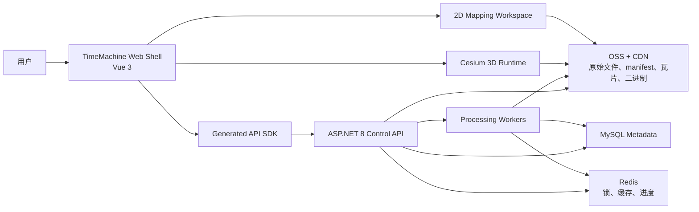

# TimeMachine Web 平台架构与 Unity 渐进替代路线

更新日期：2026-07-28

## 1. 目标和策略

目标不是制作另一个独立 Cesium demo，而是形成可以逐步接管 Unity 生产功能的
TimeMachine Web 平台：

- 用户登录和资源权限；
- 板块模型在线加载和正确的深时重建；
- 点、线、面、Raster 和时间序列图集；
- 数据上传、解析、Plate ID 分配、索引和瓦片化；
- 图层管理和用户自定义可视化；
- 项目、草稿、版本、分享和发布；
- 2D 制图、导出和后续分析工具。

采用“共享 Server、共享资源 ID、功能逐项切换”的渐进路线。Unity 在过渡期继续可用，
Web 每达到一个可验收垂直切片，就接管一类真实工作流，而不是最后一次性切换。

## 2. 推荐总体架构



核心边界：

- **Web Shell** 管用户、项目、时间轴、图层树、样式和工具编排；
- **Cesium Runtime** 管球面重建和 GPU 资源，不把大量要素放入 Vue 响应式状态；
- **2D Mapping Workspace** 复用现有投影、图例、样式和导出能力；
- **Control API** 管身份、权限、目录、项目、任务和 manifest；
- **Processing Workers** 执行解析、Plate ID 分配、剖分、索引和切瓦片；
- **OSS/CDN** 直接向浏览器分发大资产，应用 Server 不转发百万点和整幅 Raster。

## 3. 客户端应拆成的可复用组件

建议把当前 TimeMachineWeb 已验证能力拆为以下内部 package：

| Package | 职责 |
|---|---|
| `@timemachine/reconstruction-core` | ROT 解析、重建树、SLERP、四元数复合、坐标旋转 |
| `@timemachine/plate-model` | 模型 manifest、板块 mesh、时间有效性和样式 |
| `@timemachine/point-runtime` | WGP/点瓦片、GPU buffer、Plate ID quaternion lookup、拾取 |
| `@timemachine/raster-runtime` | 图集帧选择、瓦片、色带、缓存 |
| `@timemachine/project-model` | 项目、图层、样式、revision 和迁移 |
| `@timemachine/api-client` | 由 MetaMaker 生成类型封装的业务 SDK |
| `@timemachine/cesium-viewer` | 可嵌入业务系统的 Cesium 组件 |

产品 Web 应直接使用这些 package。这样“可复用组件”和“完整前后端产品”不是两套实现。

## 4. 统一领域模型

### 4.1 Asset 和 Version

板块模型、数据集、图集都采用“目录实体 + 不可变版本”：

- 目录实体保存名称、作者、权限、标签和最新版本；
- Version 保存输入哈希、处理流水线版本、模型绑定和产物 manifest；
- manifest 引用 OSS/CDN 中的不可变资产；
- 更新输入时发布新版本，不原地覆盖旧资产。

这保证旧项目可复现，也能明确“同名模型但 rotation 已变化”的情况。

### 4.2 图层

统一图层至少包含：

```text
id
name
type: plate | point | line | polygon | raster | atlas
sourceRef: resourceId + version
visible
opacity
order / groupId
timeBinding
plateModelBinding
filter
style
```

图层只是对数据源和表现方式的引用。百万点、mesh 和瓦片不能内嵌在项目 JSON 中。

### 4.3 时间

整个项目共享 `timeMa`，但每层声明：

- `validTimeRangeMa`；
- `coordinateTimeMa`；
- `plateModelId/version`；
- 超出有效期时隐藏、钳制还是报错；
- 图集采用最近帧、包含区间或插值。

性能测试中的“永久有效点”只能作为 benchmark policy，科学数据默认恢复来源时间。

### 4.4 项目和用户行为

项目保存的是“可恢复、可分享、可复现”的用户意图：

- 当前时间、相机和视图；
- 板块模型版本；
- 图层树、顺序、显隐和透明度；
- 数据源版本、过滤器、样式；
- 图集色带和值域；
- 可选选择集、书签和布局。

项目不保存鼠标移动、每一帧相机位置、GPU 对象或数据本体。

推荐三层持久化：

1. 浏览器 IndexedDB 保存未登录草稿和临时缓存；
2. 云端 draft 以 debounce 自动保存，带 `baseRevision`；
3. 用户手动“保存版本/发布”生成长期 revision。

## 5. 大规模数据的正确 Web 路径

### 5.1 点

第一阶段继续使用已验证路径：

- 服务端分配 Plate ID；
- WGP1 或后续 WGP2 紧凑二进制；
- Worker fetch/校验/transfer；
- 一个或少量 GPU buffer；
- CPU 只计算活动 Plate ID 四元数；
- 顶点 shader 查 quaternion texture 并旋转。

产品化再增加：

- 空间瓦片和 LOD；
- 可见范围、时间和属性筛选；
- 属性列与位置资产分离；
- 二进制块的 LRU、取消请求和预取；
- 5M 全常驻保留为极限 benchmark，不作为默认加载策略。

不要把百万点转成 Vue reactive object、Cesium Entity 或大 JSON。

### 5.2 板块面

- GPML geometry 在 ingest 时完成剖分；
- 同 Plate ID 共享总旋转；
- 客户端按模型版本加载 rotation 和 mesh 资产；
- 时间变化更新板块 matrix/四元数和显隐；
- topology deforming、half-stage、速度场作为后续独立能力，不能伪装成刚性重建。

### 5.3 Raster 和图集

- 原始 GeoTIFF/NetCDF 保留；
- 生成 COG/内部标准资产和瓦片金字塔；
- 客户端只请求可见层级和当前/相邻时间帧；
- 色带优先 shader 化；
- 每个 tileset 有 CRS、extent、NoData、band、level 和来源哈希；
- CDN cache key 必须包含 atlas/version/frame/z/x/y/format。

## 6. Unity 渐进替代阶段

### 阶段 0：契约和兼容层

状态：已于 2026-07-24 完成。实施细节、五张实体表、兼容约束和验证结果见
`docs/phase-0-contract-and-compatibility.md`。

工作：

- 将已验证的重建内核、点 runtime、板块 runtime 从 demo UI 中拆包；
- 从现有 TypeScript 工程抽取生成 SDK 和 RPC runtime；
- 定义 `PlateModelVersion`、`DatasetVersion`、`ProcessingJob`、
  `ProjectRevision`、`RasterTileSet`；
- 为现有 `ProjectRO`、`PlateModelRO` 建立 V1→V2 转换器；
- 建立 Web/Unity 功能开关和遥测。

验收：

- 同一模型、Plate ID、年龄在 Unity、Web 和 pyGPlates 黄金坐标间一致；
- V1 项目只读打开时不丢图层顺序、模型、时间和基本样式；
- 所有新 Entity/API 定义进入 `MetaMaker2/Define`，不手改 `CodeEx`。

### 阶段 1：第一个可用垂直切片

状态：阶段 1A 与 1B 已于 2026-07-27 完成。Canonical Vue 3 Web Shell、真实
Cesium runtime、PBDB 点图层、邮箱验证码登录、在线资源 ID/version 和带
`baseRevision` 冲突检测的云项目版本链已经落地。实施与验证记录见
`docs/phase-1a-canonical-web-shell.md` 与 `docs/phase-1b-online-workspace.md`。

优先实现用户倾向的最短闭环：

1. 登录和用户信息；
2. 在线板块模型目录；
3. Cesium 球面、板块面和时间轴；
4. 一个在线 PBDB 点数据集；
5. 基础图层树、显隐、顺序和单一符号样式；
6. 创建/打开一个云项目。

这一阶段只读数据，项目可编辑。它先替代 Unity 的“打开项目—选择模型—看点随时间
运动—保存视图”主链路。

验收：

- 页面不依赖本地硬编码数据路径；
- 模型、PBDB 和项目都通过资源 ID/version 加载；
- 时间拖动不在主线程逐点重建；
- 刷新或换浏览器后项目状态可恢复；
- 对照数据在 0 Ma 和多个非零年龄与黄金结果一致。

### 阶段 2：图层管理、点在线加载和自定义可视化

状态：已于 2026-07-28 完成。完整图层组、跨组拖拽、组/层显隐和透明度、
DatasetVersion manifest、受限 point style expression、GPU 字段样式与过滤、
row ID 拾取、请求取消、LRU、两阶段释放，以及本地/云端 revision 持久化均已落地。
实施与验证记录见 `docs/phase-2-layer-management.md`。

工作：

- 完整图层组、拖拽排序、显隐、透明度；
- point layer 使用 DatasetVersion，而不是复制点；
- 分类、分级、单值、大小、形状、透明度、字段过滤；
- 统一 style expression，并限制可执行能力，不能保存任意 JavaScript；
- 点拾取按 row ID 再请求属性；
- 数据块 LRU、请求取消和卸载的两阶段释放；
- 项目 draft 自动保存和 revision 冲突处理。

验收：

- 同一数据集可被多个项目引用且不复制；
- 275k 真实 PBDB 数据可交互使用；
- 大点集不进入 Vue 深响应；
- 修改样式只更新 uniform/lookup/必要 buffer，不重新解析数据；
- 两个页面同时编辑项目时能显式发现 revision 冲突。

### 阶段 3：数据上传、解析和发布

工作：

- OSS 分片直传；
- Excel/CSV/Shape/GPML/ROT/TIF 导入 Job；
- 字段映射、经纬度和年龄识别；
- 服务端 Plate ID 分配；
- rejected rows 和质量报告；
- 生成 typed dataset、空间索引、点资产或瓦片；
- 将已验证的 WGP1 制备流水线迁入 Worker。

验收：

- 上传请求结束后解析仍可独立运行；
- 用户可查看进度、失败阶段、日志和重试结果；
- 相同输入 hash 可以复用产物；
- 数据版本记录原文件、板块模型版本、锚定板块、分配方法和处理器版本；
- 失败不会留下可见的“半发布”数据集。

### 阶段 4：在线图集瓦片化

工作：

- 复用 `UserTimeSequenceAtlas` 目录和权限；
- ingest 原始帧，生成 COG/tileset；
- `AtlasManifest` 和时间帧选择；
- Cesium imagery provider、可见瓦片缓存、色带 shader；
- 现有整幅 GZIP PNG 路径只作兼容 fallback。

验收：

- 首屏不下载完整图集；
- 时间变化只切换需要的帧和可见瓦片；
- 同一帧换色带不重复生成整套瓦片；
- 项目保存 atlas/version、帧策略、色带和值域；
- 缺瓦片、NoData 和跨日期线有明确表现。

### 阶段 5：面、Raster、2D 制图和导出

工作：

- 大面数据的 mesh/vector tiles；
- 用户小规模注释继续走 Geo2D CRUD；
- 上传 Raster、动态色带和多 band；
- 将现有 `TimeMachineMapping` 改为共享项目模型的 2D workspace；
- 复用 proj4、图例、样式编辑和导出 UI；
- Server 端承担高分辨率、长耗时或权威导出。

验收：

- 3D 和 2D 打开同一 ProjectRevision；
- 2D 制图不再依赖 30 分钟内存 ExportData；
- 导出任务可恢复、可下载、可追溯；
- 3D/2D 样式能力不一致时有明确降级规则。

### 阶段 6：Unity 收口

工作：

- 建立 Unity 功能清单与 Web 等价验收矩阵；
- 按用户群或项目逐步把默认入口切到 Web；
- Unity 进入只读或维护模式；
- V2→V1 仅为仍需 Unity 的受支持图层提供降级；
- 完成数据迁移、审计、监控和回滚预案。

下线条件：

- 活跃项目可在 Web 打开、编辑、保存和发布；
- 核心模型与数据输出通过科学回归；
- 用户、权限、上传、任务、项目和瓦片具有生产监控；
- 不再有必须借助 Unity 才能完成的高频主流程；
- 已确定无法迁移的专业能力有独立替代计划。

## 7. 兼容期的数据策略

不建议 Unity 和 Web 各自维护一份可变项目副本。过渡期采用：

- Server 资源 ID 是唯一身份；
- V2 ProjectRevision 是新功能的长期真源；
- V1 项目先通过转换器只读进入 Web；
- Web 保存后生成 V2 revision；
- 对 Unity 仍支持的图层可按需生成 V1 兼容视图；
- 同一项目不允许 Unity 与 Web 无版本控制地同时覆盖。

现有 `ExportDataController` 只用于短期“Unity 打开 2D 制图页”兼容，不进入新项目链。

## 8. 第一批工程任务

按依赖顺序建议先做：

1. 固化共享 reconstruction/renderer package 边界；
2. 抽取 TypeScript generated SDK，接通登录、账户和 Token；
3. 做密码协议安全迁移设计；
4. 在 MetaMaker 定义 PlateModelVersion、Dataset、DatasetVersion、ProcessingJob、
   ProjectRevision 和 TileSet；
5. 将当前本地 PlateModelData 发布为第一份 PlateModelVersion；
6. 将真实 PBDB WGP1 发布为第一份 DatasetVersion；
7. Web 用 manifest 加载模型和 PBDB，移除硬编码路径；
8. 接入用户项目、图层树和样式保存；
9. 再实现上传 Job，而不是让浏览器解析原始文件；
10. 用一份真实在线图集完成第一条 Raster 切瓦片链路。

这十项完成后，Web 已经具备一个真正可替代 Unity 主浏览链路的产品骨架，而不只是
离线演示。

## 9. 质量门槛

每个阶段都必须同时满足：

- **科学正确性**：GPlates/pyGPlates 黄金数据、rotation 边界、父子板块和有效时间；
- **性能**：主线程长任务、帧时间、CPU/GPU 内存、网络字节、瓦片命中和释放延迟；
- **可复现**：资源版本、输入 hash、模型版本、处理器版本和项目 revision；
- **安全**：认证、访问控制、签名 URL、上传类型、配额和审计；
- **可靠性**：任务幂等、失败重试、取消、半成品隔离和可观测性；
- **兼容性**：V1/V2 转换测试和 Unity/Web 功能矩阵。

科学模式与极限性能模式必须在 manifest、UI 和测试报告中显式区分。
