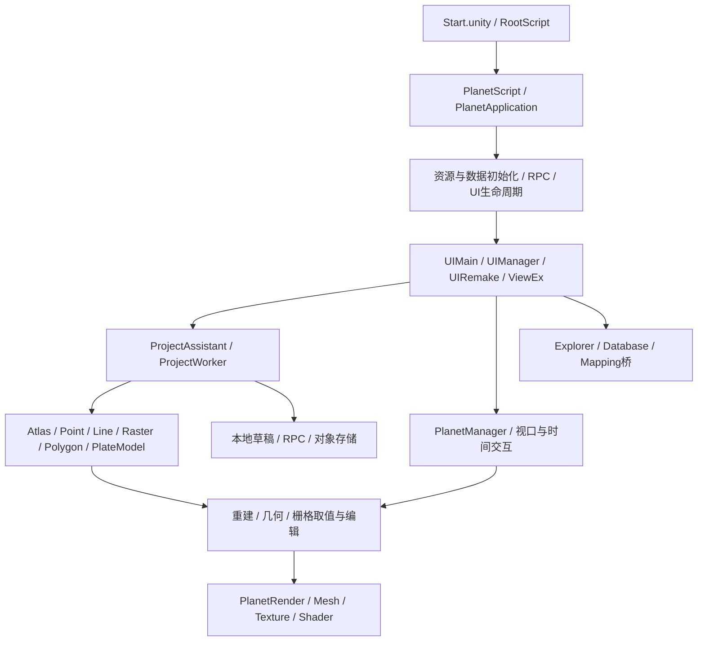
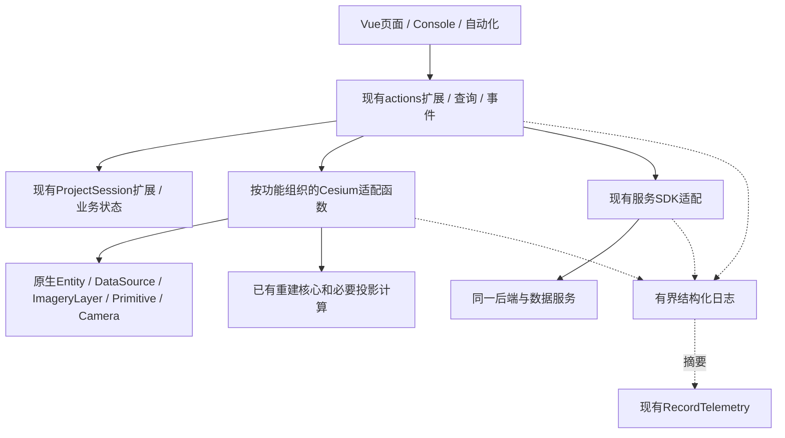
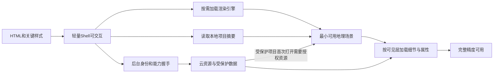
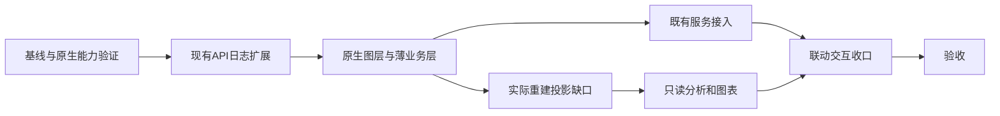

# Unity 客户端功能架构与原生 Web 迁移方案

审计日期：2026-11-14（Asia/Shanghai）  
修订版本：V3，Cesium 原生能力优先、薄业务适配（2026-11-14）。  
目标：迁移约定范围内的 Unity 客户端能力，排除数值栅格工作台；复用同一后端和数据服务，提供完整交互 API 与可追踪日志。  
人员假设：用户本人负责产品判断、数据与科学结果验收，AI 辅助分析、实现、测试；不是三人开发团队。  
文档性质：基于当前代码的设计提案与排期估算，不代表已经完成迁移，也不是对生产运行状态的保证。

## 1. 结论与证据边界

推荐直接使用现有 Vue + TypeScript + Cesium：普通几何、显示、相机、拾取、影像与集合生命周期优先交给 Cesium；项目代码只保留业务元数据、后端数据适配、板块重建和明确的投影缺口。取消预先建设引擎无关后端、通用图层插件系统与全能任务框架的安排。统一交互 API 和轻量日志沿用已有注册器/遥测基础扩展。

Unity 的范围已经超出“古地球查看器”。本次 Web 保留六类图层、双模型与四视口、四种平面投影、只读查询、项目与资源管理、表格与图表及外部应用联动；**数值栅格编辑、地形语义识别与编纂明确排除**。当前 Web 是可复用的重建与显示基础，目标是约定范围内的业务对等，不再是 Unity 全部功能迁移。

本次修订的四个硬约束：

1. Raster/Atlas 的显示、色带、帧切换和只读取值保留；栅格像元写入、笔刷、选区编辑、公式改值、补洞、撤销历史、地形识别与编纂不纳入 Web，也不改成 Web 调服务的间接入口。
2. 复用相同后端服务、身份权限、资源 ID、协议和数据服务；Web 不另建业务后端、转换平台、瓦片服务或数据库。浏览器兼容缺口单独记录，不默认变成后端重建项目。
3. 范围内的每项服务调用及语义交互均有可发现的 API 契约；日志能关联交互、状态变化、网络请求、Worker 和渲染结果。API 与日志从 P1 落地，不等功能做完再补。
4. 不修改 Cesium 源码、node_modules 或内置类型声明；通过公开 API、对象组合和项目自有业务类型扩展。每项新增底层实现先证明原生能力无法满足正确性或实测性能要求。

“原生 Web”在这里指 DOM 界面、浏览器资源生命周期、TypeScript 领域逻辑及 WebGL 渲染；少数独立算法以后可以按需使用 WASM，但不再携带整个 Unity runtime。默认迁移方案不依赖算法 WASM，是否引入由瓶颈测试决定。

### 1.1 本次核查范围

- Unity：`Assets/Scripts`、自有 `Assets/Plugins`、shader、启动场景与构建配置；按实际方法体和调用点判断，不按 README 或功能按钮名称判断。
- Web：当前工作区，包括未提交的 Mollweide 代码；跟踪启动、项目、图层、渲染、投影、代理操作和服务适配。
- 没有启动 Unity Editor、没有执行 Unity 编译、没有连接真实后端进行写入或发布，也没有完成浏览器跨平台验收。
- 对 Unity 标记为“已接线”的含义是存在 UI/业务调用及实现路径，不代表这个源码快照运行通过。

### 1.2 Unity 基线存在实质性不确定性

`Assets/Scripts` 中扫描到 **986 个 C# 文件，其中 CodeEx 415 个、UIManager 276 个、ProjectWorker 79 个、Planet 76 个**。这些只是代码分布，不用来推算完成百分比。

**8 个 C# 文件包含 26 组未解决冲突起始标记**，涉及 PlanetManager、PlanetProjectionViewportService、PlanetOperator、UIViewManager、UIMainManager、UIMainLayerControllerManager、UIIdentifyResults、UIIdentifyResults.ProjectionRasterWorkspace。冲突分支可能表达不同交互方案，不应把双方功能简单求并集后当成已发布能力。P0 必须确定无冲突的参考版本、最后一个可运行版本及保留分支。本次未擅自解决冲突。

Unity `CodeEx` 是生成协议层，项目规则禁止手改；协议变化必须经 MetaMaker 定义与生成流程处理。源码文档中的操作建议不构成本次修改或部署授权。

### 1.3 已取得的 Web 验证

- 初始审计快照：TypeScript 检查通过；43 个测试文件通过、1 个跳过；528 项通过、5 项真实服务测试跳过。
- 初版审计轮：隔离输出目录的 Vite 生产构建成功，未覆盖项目原有 dist。V2/V3 均仅修订方案，没有重新构建应用。
- 上述结果证明本机代码的测试与打包状态，不证明 Unity 功能等价或冷启动性能达标。

后续工作区已有SDK、API/日志和投影任务/RPC的部分实现；最新存档为679项通过、5项跳过以及对应构建/局部浏览器证据。此次前置文档复核仅确认268份源码hash与该证据匹配，没有重跑这些检查。下文初始差距表仍保留审计时点含义，正式实施按Goal台账读取当前剩余工作，不重复生成已有模块或将部分切片当成阶段完成。

[P0–P3 当前任务与证据台账](/Users/user/Desktop/Work/CodeRepo/TimeMachineWeb/docs/superpowers/plans/2026-11-14-p0-p3-goal/05-progress.md)

## 2. Unity 当前客户端功能架构



此图表达静态调用关系；含冲突文件的分支要在 P0 固定之后才能认定为最终运行关系。[U01–U05]

### 2.1 生命周期与资源

RootScript 初始化运行平台、资源路径和 RPC，装载根对象后转入 PlanetScript／更新器。PlanetApplication 负责序列化注册、资源系统、数据加载、UI ready 流程、定时器、逐帧更新与资源释放。Web 应迁移这些职责，不能照搬 MonoBehaviour、GameObject、AssetBundle 和全局 Update 循环。

### 2.2 项目与图层

ProjectWorker 根据图层类型分派六类 worker。项目不仅是相机和时间，还包括层级、资源引用、样式、访问范围、编辑状态与云同步关系。图层和渲染生命周期有耦合，这是需要重新设计的边界。

| 图层类型 | Unity 中的主要职责 | 原生 Web 需要保留的语义 |
|---|---|---|
| PlateModel | 板块几何、旋转模型及其显示 | 模型版本、锚定板块、年代有效性、来源与坐标约定 |
| Point | 表格字段映射、点显示、重建、查询 | 稳定 feature ID、属性表、年代区间、板块归属、样式 |
| Line | 线几何显示与随时间更新 | 线拓扑、跨经线切分、端点／属性与拾取 |
| Polygon | 面、填充／边界、导入与持久化 | 外环／内洞、原始拓扑、重建后几何、属性 |
| Raster | 数值波段、显示、采样与局部编辑 | 仅保留 CRS、网格、NoData、只读取值、色带和显示；不迁移编辑历史 |
| Atlas | 时序栅格帧及当前帧操作 | 仅保留帧索引、有效年代、缓存、只读取值和显示 |

### 2.3 时间、模型与投影

代码定义 Globe A、Globe B、Projection A、Projection B 四个视口角色，以及 Rectangular、Mercator、Mollweide、Robinson 四种平面投影。存在正反投影、投影几何、屏幕选取和栅格编辑路径。双模型、视口绑定、当前时间与原始数据位置必须是显式状态，不能依赖一个全局 camera 或一个全局 renderer。[U03–U05]

Unity 可见时间范围代码含 4500 Ma，Web 当前界面有 538.8 Ma 限制；迁移时应由模型与项目能力决定范围，同时处理超出模型覆盖的提示。不能仅把滑块上限改大，也不能把“末端旋转延用”误当成有科学依据的新年代重建结果。[U03、W01、W02]

### 2.4 数值栅格工作台：已审计，明确不纳入 Web

Unity 存在像元与区域编辑、笔刷、复制粘贴、公式变换、补洞、海平面调整、均衡补偿、水深计算、地形／水深编纂及地形语义识别的实现路径。[U06–U10]

这些代码只用于解释 Unity 功能边界，不进入 Web 功能验收、包依赖、交互 API 的可执行集合或工期。删除原方案中的 raster editor、像元 patch、overlay history、检查点和相关算法移植阶段；不因为后端可能提供类似能力而重新纳入。

保留 Raster/Atlas 查看、色带、时序播放和只读采样。独立的科学图表、表数据编辑、自定义色带、只读条件面积分析仍在范围内：它们不写入栅格，不提供地形编纂工作流。只读面积分析按独立分析模块验收，不依赖被排除的工作台。

读取含 Unity 栅格编辑字段的旧项目时，保留不认识的原始字段与资源引用并给出兼容性报告；已有服务返回的发布成品可展示，但 Web 不承诺重放客户端私有编辑日志。必要时只读打开或另存，避免保存时丢失旧数据。

### 2.5 外部系统与平台适配

业务代码存在账号、资源市场、项目本地／云保存、发布／克隆、文件导入与外部 Explorer／Database／Mapping 联动。它们依赖服务端能力和数据，不应假设全在浏览器本地完成。[U11–U15]

本地 CGAL DLL／包装代码存在，但审计未发现其作为主业务首帧必经调用；已检查的形状解析和球面面片网格转换走服务端 API。不能因目录有 DLL 就安排整库 WASM 编译。[U16]

### 2.6 运行时功能与开发工具分开

Unity Editor 中的数据导出、构建和资源打包工具不直接算作用户客户端功能。预处理优先复用现有服务和产物；必要的本地资源准备可用独立脚本，不新建数据加工服务。GameObject prefab、UIToolkit 页面和 Unity shader 不能原样在浏览器运行；分别重建为 Vue 组件、Web 交互以及渲染适配，图标／色带／字体等素材按实际使用情况转换与按需加载。

测试、调试面板和遗留 UI 与正式工作台并存。P0 按“从启用场景或业务入口可达、非空执行、产生可核验结果”确认是否纳入等价迁移，不能把所有脚本文件都逐一移植。

## 3. 功能对照：以迁移能力而非按钮数量计进度

状态定义：**范围外**＝用户明确排除，不安排实现；**保留增强**＝Web 有实际实现但需扩大边界；**补齐**＝缺少 Unity 相应能力；**核实**＝源快照冲突或仅有局部实现；**新增**＝Unity 本身也未完成，不纳入等价迁移承诺。

| ID | 能力 | Unity 代码证据／边界 | 当前 Web | 迁移处理／阶段 |
|---|---|---|---|---|
| F01 | 旋转模型与板块重建 | 模型与 worker 更新链 | rot/GPML/四元数/旋转树已实现 | 保留；补多模型、年代和独立参考校验，P2–P3 |
| F02 | 地球相机与时间播放 | 相机、时间、方向、视口状态 | 单地球、时间轴、播放已实现 | 保留；统一命令与帧状态，P1–P3 |
| F03 | 任意图层实例和层级树 | 六类 worker、项目树 | 固定四个 runtime 槽位、一层分组 | 轻量业务树 + Cesium集合引用表，P2 |
| F04 | 点／表格属性 | 表格、重建、查询、导出链 | WGP1 特化格式、样式和拾取 | 属性 sidecar／分块索引，P2–P3 |
| F05 | 线图层 | ProjectLayerLineWorker | 未见通用线 runtime | 直接用PolylineGraphics/PolylineGeometry，适配字段/年代；特殊投影另处理，P2/P3 |
| F06 | 普通多边形 | Polygon worker、导入／保存 | 板块 polygon 不等于通用面层 | 直接用PolygonGraphics/PolygonHierarchy/原生拾取，适配业务属性，P2/P3 |
| F07 | 静态栅格与色带 | 数值读取、色带、显示 | 瓦片显示与选择 | 直接用ImageryLayer/provider；适配原服务与取值，P2/P3 |
| F08 | 时序图集 | 帧运行时、采样、编辑 | 最近帧显示、超范围隐藏 | 保留帧语义、缓存和只读采样，排除编辑，P3 |
| F09 | 四平面投影 | 四种投影及正反映射 | Rectangle/Mollweide 仅板块 | 六类层的投影/时间/拾取一致性，P3 |
| F10 | 双模型和四视口 | 角色与绑定代码；冲突待确认 | 单 viewer／单当前模型 | 复用Viewer/Camera；适配视口布局/模型绑定/同步，不写多视口引擎，P3 |
| F11 | 项目草稿／恢复 | 本地项目、缓存、刷新恢复 | localStorage 精简快照 | 补全保存/恢复与兼容报告；容量需要时再用IndexedDB，P2 |
| F12 | 云项目与版本 | 云同步与发布路径 | V2 保存／打开，能力门控 | 无损适配、冲突处理、失败重试，P2/P4 |
| F13 | 账号与资源市场 | 登录、目录、访问范围 | 登录、共享模型／版本目录 | 分离首帧；完善检索、分页与权限，P1/P4 |
| F14 | CSV/Excel 导入 | 表格映射与创建 | CSV/TSV/TXT 服务导入链 | 保留；补 Excel 与通用表结构，P4 |
| F15 | GPML/ROT/Shape/栅格导入 | 创建与既有服务解析链 | 模型加载不等于创建；点导入已实现 | 直接适配已有上传/解析接口；能力缺口明确报出，P4 |
| F16 | 像元值／属性识别 | IdentifyResults 与 raster value 服务 | 点／板块拾取；无通用数值栅格取值 | 统一只读拾取和查询，P3 |
| F17 | 栅格区域／线／选区编辑 | 投影视口与选区服务，部分冲突 | 未实现 | **范围外**；普通要素选中/框选查询仍保留 |
| F18 | 栅格笔刷／复制粘贴／公式／平滑 | 实际 UI → 编辑服务 | 未实现 | **范围外** |
| F19 | 栅格撤销重做与历史恢复 | 工作台 → 历史管理器 → overlay | 未实现 | **范围外**；不影响项目草稿和表格保存 |
| F20 | 地形语义查询 | 多种 Query…Async 调用 | 未实现 | **范围外** |
| F21 | 地形编纂与海平面／水深改值 | 实际编辑服务与 UI 调用 | 未实现 | **范围外** |
| F22 | 发布／克隆／分享访问 | 云业务调用 | publish 为 unsupported | 调用同一后端；共享只读场景，P4/P6 |
| F23 | 重建坐标表格导出 | 有真实 Excel 导出 | export 为 unsupported | 先 CSV/Excel 与坐标语义，P4 |
| F24 | 通用导出对话框 | ExecuteExport 仅日志 | 未实现 | 新增需求，不计本次基线；不能虚报格式支持 |
| F25 | Explorer/Database/Mapping 联动 | postMessage、导入桥、HTTP export | 未见对等业务闭环 | 原生 Web 消息与现有服务适配，P4/P6 |
| F26 | 菜单／设置／城市／搜索等 | 具体按钮逐项核实 | 多个明确占位动作 | P0 固定清单，每项有交互 API，P6 |
| F27 | 启动／内存／错误恢复 | Unity 资源管理 | 部分缓存/取消；启动全局等待 | 性能预算、日志与任务取消，P1/P7 |
| F28 | 第三方身份／账号绑定 | Google 登录与绑定调用 | 用户名/邮件已有部分 | 复用相同身份服务，处理浏览器登录适配，P4/P6 |
| F29 | 属性条件／跨库检索／地名 | DBCrossSearch 与地名服务 | 地点搜索占位 | 同一服务查询、分页和结果建层，P4/P6 |
| F30 | 模型／Atlas 资源生命周期 | 创建、更新、发布和元数据 | 以选择为主 | 复用原资源管理协议、版本与授权，P4/P6 |
| F31 | 科学图表及导出 | 古纬度模拟；古温度/古 DEM 服务；饼图及 PNG/XLSX/SVG | 未见对等实现 | 复用现有分析/导出服务，前端图表懒加载，P5 |
| F32 | 表数据与字段编辑 | 行增删、字段定义和提交服务 | 导入预览不等于通用表编辑 | 虚拟表格、增量编辑、类型校验和保存，P4 |
| F33 | 自定义色带资源 | 节点、CPT/JSON、保存/另存 | 缺资源编辑 | 样式与资源编辑保留，不写栅格，P4 |
| F34 | 只读 Atlas 条件面积分析 | 阈值与球面面积；导出为空 | 未见对等分析 | 独立只读分析、复用数据；不引入编辑工作台，P5 |
| F35 | 全量服务 API 契约目录 | 原有生成协议/Invoker | 有 generated-api/RPC，缺统一调试目录 | 自动盘点与 schema、服务能力状态、既有端点适配，P0/P1并持续维护 |
| F36 | 完整前端交互 API | Unity 交互重建为应用命令 | 已有 timeMachineAgent 基础 | 所有范围内语义交互/查询/事件 API 化，P1并随功能验收 |
| F37 | 结构化日志与诊断 | 复用原服务遥测能力 | 有 RPC telemetry hook 和 RecordTelemetry，缺统一贯通 | 日志、trace、任务状态、调试面板、诊断导出，P1/P7 |

不提供“已完成 30%/50%”这样的比率：六类图层、属性、投影、云业务与调试基础设施的工作量相差很大，且 Unity 当前存在冲突。应以此表中的验收场景作为进度单位。

另查到 GeometryPolygonEditor 的 AddPoint/Hole/Close 等底层实现，但本次搜索未发现 AddPoint/Close 的业务消费路径，仅确认已有面的绘制使用。因此“完整交互式矢量编辑器”暂列待核实，不因类名就算作已上线；若用户要求新增绘制/顶点编辑工作流，应在 P0 补明确范围和工期。图表、表编辑、色带和面积分析证据见 U17–U20。

导出按调用链区分：点重建坐标 Excel、图表 PNG/XLSX/SVG、外部 Mapping 转交都有非空执行路径；统一多格式地图/数据导出窗口和条件面积结果导出仍是占位。“PNG 导出”必须注明是图表还是整个地图，不能混为一种完成状态。

## 4. 复用、适配与必要自研清单

采用三档实施：**D 直接复用**＝调用原生公开API，不重新实现；**A 薄适配**＝转换现有数据、加业务元数据并协调调用；**C 必要自研**＝库没有业务语义或实际验证存在缺口。D也需要接线和测试，不等于零工期；A不等于给每个Cesium类再造一个对应类；C优先保留现有项目实现，不重复从零开发。

### 4.1 实施矩阵

| 能力 | D：直接复用 | A：本项目适配 | C：确实需要的自有逻辑 | 默认做法 |
|---|---|---|---|---|
| 普通Point | Entity.point/billboard、PointPrimitiveCollection | 坐标、属性、样式、稳定ID、年代显隐 | 板块重建位置；极大动态集的专用路径需测量 | 新小中型数据先Entity；现有GPU点路径保留 |
| 普通Line | PolylineGraphics/PolylineGeometry/PolylineCollection | 坐标序列、线宽/颜色、属性与模型绑定 | 特殊投影后的切缝/重建更新缺口 | 不写通用折线渲染器 |
| 普通Polygon | PolygonGraphics/PolygonHierarchy/PolygonGeometry | 外环/洞、业务属性、样式、有效年代 | 特殊模型/投影下确有必要的几何准备 | 原生多边形优先，不复制一套通用三角剖分 |
| 图层集合 | CustomDataSource/EntityCollection、DataSourceCollection、PrimitiveCollection | layerId→集合/对象句柄，多实例与业务组树 | 无需通用图层插件框架 | 一个业务层通常对应一份或少数原生集合 |
| 静态Raster | ImageryLayer、UrlTemplate/WMS/WMTS/SingleTile provider | 原服务URL/授权/坐标约定与取值接口 | 原服务不提供取值时的只读数据访问；特殊投影见下 | 不重写瓦片下载/LOD调度 |
| Atlas | 同一ImageryLayer/provider机制 | 年代→帧、切换、缓存引用与过期请求处理；已有控制器继续使用 | 通常无需新增底层实现 | Atlas是时序业务组合，不是新的底层栅格引擎 |
| GeoJSON/TopoJSON输入 | GeoJsonDataSource | 属性/样式映射；其他后端格式按原协议接入 | 通常无需新增底层实现 | 不强制把WGP1或二进制协议转为GeoJSON |
| 常规相机/拾取 | Viewer、Camera、Scene.pick/drillPick、原生输入控制 | 命令参数、featureId映射、业务状态回读 | 特殊投影坐标回算、已有大点集拾取缺口 | 不接管全部原生鼠标控制与相机数学 |
| 样式/透明度 | Graphics、Material/Appearance、ImageryLayer显示参数 | 业务样式字段映射、组合组透明度 | 原始数值色带若已有服务不能提供则局部适配 | 点线面样式用原生；图片亮度不冒充数值色带 |
| 标准球面/2D路径 | Cesium场景模式、GeographicProjection/WebMercatorProjection | 本项目球体半径、相机与状态切换 | 应用特有显示一致性 | 核对场景/影像限制，不假定所有投影可任意互换 |
| Mollweide/Robinson | 复用Geometry/Primitive/材质等绘制基础 | 业务图层到投影几何的接入 | 正反投影、接缝/极区、采样与拾取等实际缺口 | 保留当前Mollweide工作；Robinson及全图层需验证 |
| 板块重建 | 数学/几何与球面Primitive变换的可用部分 | 模型ID、锚板、年代、图层归属 | rot解析/旋转树/插值和有效性，已有TS核心继续用 | Ma保持业务时间，不将其直接等同JulianDate |
| 双模型/多视口 | 多个原生Viewer/Scene/Camera，按需创建 | 布局、绑定、相机同步、源数据共享 | 联动业务规则 | 先1→2→4视口测量；不预造共享GPU后端 |
| 资源/项目/权限 | 原有生成SDK和同一后端 | 页面表单、DTO映射、兼容保存、浏览器认证 | 客户端草稿与已确认的迁移规则 | 不改后端数据定义，不重新实现权限系统 |
| 只读分析/图表 | 原分析/导出服务；合适的现成图表组件 | 输入参数、结果和图表样式 | 原本在Unity客户端的古纬度/面积等必要计算 | 单独小函数/Worker，不建设分析引擎 |
| 前端交互API | 已有agentActions注册器 | 公开方法/schema、事件及状态映射 | 必要的应用命令/任务关联 | 不封装全部Cesium API，不造通用RPC平台 |
| 日志 | 已有RPC telemetry/RecordTelemetry、浏览器错误事件 | trace、状态/渲染关联、诊断面板 | 轻量有界日志缓冲与脱敏导出 | 不建设分布式追踪/日志服务器 |

当前代码已经复用这些能力：球面Polygon通过PolygonHierarchy和PolygonGeometry.createGeometry准备几何；Raster通过UrlTemplateImageryProvider与ImageryLayer显示。因此这两条路径继续使用，不计入“重写几何/瓦片引擎”的工期。现有Raster关闭了enablePickFeatures，影像显示不能视作原始数值查询已经实现。

[球面多边形几何实现](/Users/user/Desktop/Work/CodeRepo/TimeMachineWeb/packages/cesium-runtime/src/geometry.ts:53)

[现有Raster原生影像接入](/Users/user/Desktop/Work/CodeRepo/TimeMachineWeb/packages/raster-runtime/src/single-raster-layer-controller.ts:104)

只读取值和数值色带的前提在P0核实：原有服务是否提供采样接口、原始数值资源或服务端色带。只有着色后的RGBA瓦片时，无法恢复可靠原值；有原始数值资源时才安排必要的读取/解码/着色适配。若均不可用，明确记录数据能力缺口并重新评估该功能，不默认新建数据服务，也不将其视作Cesium已解决。

公开能力依据：Cesium的Entity聚合点/线/面等显示对象；CustomDataSource管理一组Entity；Primitive支持几何批处理及实例拾取，PointPrimitiveCollection支持点集合。选择哪一层由实际数据与更新模式决定，不给固定点数阈值作保证。

[Cesium Entity](https://cesium.com/learn/cesiumjs/ref-doc/Entity.html)

[CustomDataSource](https://cesium.com/learn/cesiumjs/ref-doc/CustomDataSource.html)

[Primitive](https://cesium.com/learn/cesiumjs/ref-doc/Primitive.html)

[PointPrimitiveCollection](https://cesium.com/learn/cesiumjs/ref-doc/PointPrimitiveCollection.html)

[PolylineGeometry](https://cesium.com/learn/cesiumjs/ref-doc/PolylineGeometry.html)

[PolygonHierarchy](https://cesium.com/learn/cesiumjs/ref-doc/PolygonHierarchy.html)

[影像provider](https://cesium.com/learn/cesiumjs/ref-doc/UrlTemplateImageryProvider.html)

### 4.2 哪些工作不再提前做

- 不建设RenderBackend、多引擎接口、插件注册/发现系统；当前明确以Cesium为实现目标。
- 不重写标准点线面几何、普通材质、普通拾取、瓦片调度、常规相机控制。
- 不要求每种静态层都实现prepare/commit帧协议；异步重建/投影保留已有generation机制，静态Entity/ImageryLayer直接设置公开属性。
- 不统一替换所有现有代码：GPU点、plate renderer、Mollweide等已有实现先保留。确有更简单原生替代时，用同数据基准验证正确性与性能后逐项替换。
- 现有GPU点路径使用部分Cesium低层接口，继续集中隔离、固定依赖版本并做升级回归；保留它不代表所有调用都属于稳定的高层API，也不作为新功能默认接入方式。
- 不把所有纯函数移入Worker；原生已有异步几何处理的路径先复用，只有主线程实际阻塞或必须取消的计算才新增Worker。
- 不在首版引入第二个GIS引擎、WebGPU、算法WASM、OPFS或新的二进制格式作为前置条件。明确缺口另做小型验证与决策。

普通新功能遵循“原生Entity/DataSource → 原生集合/Primitive → 必要的专用实现”。这个顺序是选择路径，不要求现有高性能实现退回Entity，也不保证任意动态几何都能靠modelMatrix解决。Primitive变换应核对场景限制，特别不能把球面3D技巧直接套到2D/Mollweide。

### 4.3 新自研的准入条件

每个新底层模块简要记录：业务要求、尝试过的Cesium公开API、失败样本/性能测量、最小补充逻辑、验证方式。记录可直接放在对应任务中，不另建审批流程。只有标准路径无法满足正确性或预算，才增加实现；仅凭“可能以后换引擎”不成立。

性能目标保留，但先优化入口加载、云等待、数据量和现有原生选项；预算失败不能自动触发整个渲染引擎重写。难点主要仍是板块业务、非标准投影、多视口和旧项目互通，并不会因几何类现成而消失。

开发便携性保持：安装约定Node与依赖后即可打开本地示例；真实服务用独立配置接入，不要求本机Unity或邻接DPlanet源码。生成契约保持同源和固定版本。Vite支持按需chunk，但仍需核对当前Cesium插件的同步脚本注入。[Vite官方说明](https://vite.dev/guide/features)

## 5. 精简的目标 Web 架构



这是少量应用模块及映射函数，不是新的框架。保留现有packages边界；只在功能需要时提取文件，不为了图示提前创建十几个包。

### 5.1 实际代码边界

| 位置/模块 | 最小职责 |
|---|---|
| 现有Vue组件与功能文件 | 表单、面板、状态显示，业务操作调用actions |
| 现有agent-actions | 稳定actionId、校验、handler、查询/事件扩展；不代理每个Cesium内部方法 |
| 现有project-session与layer controller | 可保存业务配置、任意图层实例/组；一份权威状态 |
| 少量cesium-bindings函数 | 数据到Entity/DataSource/ImageryLayer的转换；样式设置；picked id到业务记录的映射；释放引用 |
| 现有reconstruction-core/projection/专用renderer | 仅保留库不提供的重建和投影/性能路径 |
| 现有api-client/platform-runtime | 原服务协议、能力、认证和遥测 |
| 一个logging模块 | trace、有限缓冲、过滤/脱敏/导出；可选UI面板按需加载 |

实例表可以是 `Map<layerId, { dataSource?, imageryLayer?, primitives?, dispose }>`；多视口时增加viewport维度。这只是对象引用管理，不另造与Cesium平行的图层继承体系。业务组树可以有任意层级，但渲染调用映射到原生集合。

### 5.2 薄业务扩展不是修改 Cesium 定义

**不修改Cesium源码或其.d.ts，不给原型打补丁，不复制Entity/PolygonGeometry重新命名。** 项目定义少量自有元数据类型，用组合持有原生对象。调用公开属性改变显示，属于正常使用API，并非修改库的数据定义。

以下是最小组合示例；`viewer`和已按本项目球体/坐标约定生成的`positions`由调用方提供：

```ts
import { Color, Entity, PolygonHierarchy, Viewer, Cartesian3 } from "cesium";

type PlateFeatureView = {
  plateId: number;                  // 自有业务元数据
  modelRef: string;
  ageRangeMa: readonly [number, number];
  entity: Entity;                   // 原样使用Cesium对象
};

function addPlateFeature(viewer: Viewer, positions: Cartesian3[]): PlateFeatureView {
  const entity = viewer.entities.add({
    id: "layer-1:feature-101",
    polygon: {
      hierarchy: new PolygonHierarchy(positions),
      material: Color.CYAN.withAlpha(0.5),
    },
  });
  return {
    plateId: 101,
    modelRef: "resource:plate-model:1",
    ageRangeMa: [0, 200],
    entity,
  };
}
```

这是演示数据，不是生产ID/模型或重建算法。时间变化时先用现有RotationModel求业务结果，再更新原生显示对象，或使用已验证的批量路径。修改了对象实例的值，不修改Cesium类型定义。

少量随要素一起拾取的元数据，也可用官方 `Entity.properties` / `PropertyBag`；大型属性表、原始坐标、权限与资源版本留在项目自己的数据结构中，以稳定ID关联。两种方案任选合适的权威数据源，避免属性副本各自修改。PropertyBag使用Cesium Property语义，不能把它当成任意可深改的JSON对象。[PropertyBag文档](https://cesium.com/learn/cesiumjs/ref-doc/PropertyBag.html)

项目持久化保存来源引用、年代、样式、视口配置和必要业务字段，不直接JSON序列化Entity或GPU对象。每次打开按业务数据重新创建对象。原始几何与重建显示几何分开，不能在每次拖年代时反复覆盖原始坐标。

通用GeoJSON输入直接使用GeoJsonDataSource；已有后台二进制和WGP1保持原协议，转换为原生对象/数组即可，不为统一形式强制复制成巨型GeoJSON。[GeoJsonDataSource文档](https://cesium.com/learn/cesiumjs/ref-doc/GeoJsonDataSource.html)

日志与API完整契约继续适用，但实现从已有注册器出发，不要求先完成通用框架。

### 5.3 一致性与资源生命周期

只对异步重建/投影保留当前requested/committed和generation逻辑；静态层直接使用原生属性与集合。关联视口中需共同变化的图层完成必要准备后提交，过期结果丢弃；不为所有图层制造相同帧生命周期。拖动年代合并中间请求，禁止旧结果覆盖新状态。

必须区分：必需层失败时保留旧帧并提示；可选层失败时允许以显式缺失状态提交；不能悄悄把两个年代的图层叠在一起。涉及重建结果的导出必须等待目标年代计算完成，不使用交互时的跳帧结果。

任意层卸载必须释放 GPU、Worker job、事件监听和缓存引用；资源切换使用可取消热替换，逐步消除整页 reload。维持一份领域状态，DOM、控件、代理 API 均从它派生。

RPC 和资产请求统一传递 AbortSignal、超时与任务身份；重试只针对可安全重试的操作，写入须使用服务支持的幂等机制或显式状态查询。将网络初始化移到后台并不能解决无限挂起和过期回调，P1 就应处理这些问题。

### 5.4 数据与算法部署位置

| 工作 | 默认执行位置 | 约束 |
|---|---|---|
| 相机、UI、样式、绘制 | 主线程 + GPU | 业务动作走交互API；原生相机手势用事件同步，高频动作合并 |
| 旋转、解析、投影几何、索引、只读面积 | 先复用原生/现有路径；实测阻塞时使用TS Worker | 不为所有计算自动新增Worker；取消与所有权明确 |
| 文件解析、已有数据加工、资源管理、分析查询、服务导出 | 原有后端/数据服务 | 复用协议与业务语义，不重做服务实现 |
| 不变模型mesh和LOD | 优先消费现有产物，或前端Worker与缓存 | 若服务不提供预处理资产，作为明确缺口，不把服务新建当成前提 |
| 本地预览/表格编辑与图表渲染 | 按需前端模块 | 正式持久化仍调用原有接口 |

ArrayBuffer transfer 后发送端失去使用权，Worker 与缓存必须明确所有权；不能转移后仍读取同一原buffer。[MDN Transferable objects](https://developer.mozilla.org/en-US/docs/Web/API/Web_Workers_API/Transferable_objects)

### 5.5 API 优先的开发方式

保留 `window.timeMachineAgent` 的现有基础并版本化扩展，统一挂载接口发现、命令执行、状态查询、事件订阅、任务管理和诊断能力。UI业务操作、Console、自动化和调试面板调用同一个应用处理器；原生相机手势通过事件同步状态，程序化接口调用同一原生能力。禁止用调试专用 DOM 点击模拟或直接改内部 store 来代替真实交互。

服务 API 与前端交互 API 分开：前者适配既有远端协议；后者是页面内语义接口，不需要新增 HTTP 服务。完整 API 清单要在功能实现前声明，至少包含参数/结果schema、说明、版本、权限/能力条件、副作用、完成语义和状态。未实现返回明确 unsupported/not-implemented，不能空方法返回成功。

“所有接口”指既有应用相关的全部服务操作，以及本次范围内所有用户可感知的交互、查询和状态事件。范围外栅格工作台列入范围登记，不提供可执行入口；与应用无关的管理后台操作不额外暴露。生成协议目录可保留未启用服务描述，但不会自动给它们执行权限。

### 5.6 复用后端、数据与项目兼容

Web 和 Unity 使用同一后端服务、数据服务、账号与权限、资源及项目标识。优先复用 MetaMaker 生成契约、现有 ByteStream/JSON RPC、上传/下载、既有瓦片与分析接口；不新建 BFF、业务库、数据转换后台或独立遥测服务器。

P0 形成“Unity Invoker → 原有端点/协议 → Web adapter → 所需浏览器条件”映射，核查 CORS、认证、文件传输、响应格式与能力版本。同一服务不等于无需浏览器适配：缺失能力用显式错误或暂不可用状态表示。确需服务配置/协议变化时单列差异和授权任务，不默认改数据表或服务部署。

旧项目导入报告支持字段、保留字段、范围外字段和缺失资源；原项目不能因 Web 不支持栅格工作台而丢失数据。未知字段不能无损写回时，采用只读或另存；现有发布成品可展示，客户端overlay不能伪装成已执行。

将 generated-api 从本地邻接源码路径依赖改为固定版本的同一生成产物或可复现生成步骤。API目录从该产物提取，不维护另一套后端DTO。

项目草稿先复用现有存储；数据规模超出小配置存储时再引入IndexedDB，OPFS不列首版前置条件。缓存可能被回收，草稿必须有明确保存状态及恢复出口。[MDN 存储配额与回收](https://developer.mozilla.org/en-US/docs/Web/API/Storage_API/Storage_quotas_and_eviction_criteria)

生产 Web 接入现有数据/瓦片服务。本地 Vite middleware 可以保留用于fixture开发，不能把本地路径当成正式数据地址，也不因 Web 迁移而要求重建 Martin 或数据存储。

### 5.7 日志与调试系统

已有 `RPCClient.onTelemetry` 与 `TimeMachinePlatformRuntime.recordTelemetry` 可复用，但目前不能等同于完整日志系统。新增统一结构化日志入口、阶段事件、全局异常/Worker错误收集、任务/请求关联、过滤与诊断导出。

每次交互生成 traceId，关联 actionId、requestId、jobId、viewportId、generation、状态revision、耗时和结果；并区分 HTTP 成功、业务成功、场景已提交。日志包含足够的脱敏上下文，不复制完整请求/响应、上传文件、Token、密码或签名URL。

默认本地有界环形缓冲，开发模式提供按级别/模块/trace过滤及JSONL诊断导出。生产保留错误和必要指标，debug按会话启用。存在既有遥测能力时仅映射允许的摘要到 RecordTelemetry；不创建新日志后端，不假定该接口有日志搜索或批量存储能力。日志失败不得打断业务或形成遥测递归。

配套规格：

[前端交互 API、服务契约与日志设计](/Users/user/Desktop/Work/CodeRepo/TimeMachineWeb/docs/web-api-and-logging-design-2026-11-14.md)

## 6. 首帧设计与可验证预算

### 6.1 当前实测的是构建体积，不是加载时长

初版审计构建的产物中，HTML 同步加载 `/cesium/Cesium.js`，随后才加载应用模块。gzip 数据是本地压缩结果，实际网络是否压缩、缓存和 RTT 尚未测量。

| 产物 | 原始大小 | gzip 大小（约） |
|---|---:|---:|
| Cesium.js | 5,909,848 B | 1,726,812 B |
| 应用入口 JS | 439.22 kB | 137.40 kB |
| 应用 CSS | 50.79 kB | 11.46 kB |
| 本地 PALEOMAP GPML | 5,322,916 B | 420,499 B |
| 本地 rot | 80,411 B | 20,302 B |
| Mollweide Worker chunk | 267.38 kB | 未单独统计 |

这不是每次访问的总下载量：GPML/rot 取决于所选模型，Worker 取决于模式，Cesium 还可能请求其他资源。Vite 输出没有把外置 Cesium.js 算进应用入口 chunk，不能仅用 137 kB 声称应用很轻。

当前主链是：同步引擎脚本 → Vue 挂载 → 等云初始化／目录／身份 → 获取模型 → 解析与完整三角剖分 → 组装其他图层 → 等平台初始化 → 固定 420 ms → 移除遮罩。[W01、W09]

### 6.2 新加载路径



首个地理场景必须属于用户选择的项目或明确标识的演示／预览，不能拿一个快速出现的空球冒充项目加载完成。受保护项目仍需授权后才能取数据；离线本地场景和 UI 不应被云目录阻塞。

具体顺序：

1. 拆轻量 shell 与编辑工具；处理 Cesium 插件同步注入，验证最终 HTML 的加载顺序。
2. 挂 shell 后立即并行读取本地摘要与加载必要引擎；云身份、目录和可选工具从关键路径移出。
3. 原服务具备低分辨率模型／预处理 mesh 时优先消费；否则加载原协议数据，在 Worker 解析并渐进显示，不将新增后端产物作为首版前提。仅加载该项目首帧必需资源。
4. 优先使用原生异步加载/几何准备，按可见性补详情；仅对主线程瓶颈新增Worker或分批处理。状态按层显示，不使用全局遮罩等所有数据。
5. 移除无业务必要的固定 420 ms；后台缓存、预取有并发与内存预算。
6. 表格编辑器、图表、调试面板与完整API目录按需加载；核心交互路由和最小日志缓冲轻量初始化，不能为debug重新引入首帧大包。

按需渲染可用于静止场景减少 CPU/GPU 消耗，但不能代替首帧包体优化；数据变化必须显式 requestRender。[Cesium Scene 文档](https://cesium.com/learn/cesiumjs/ref-doc/Scene.html)

### 6.3 建议验收目标，P0/P1 实测后冻结

基准建议：一台固定型号集显笔记本，1920×1080、DPR 上限 1.5，当前稳定浏览器；生产构建，10 Mbps 下载、80 ms RTT，固定轻量示例项目，分别测冷缓存和热缓存。必须记录设备、浏览器版本、压缩方式和缓存状态。至少 20 次冷启动取 p50/p95；尾部数据不稳定时增加样本，不选最好一次。

| 指标 | 建议目标 | 定义 |
|---|---|---|
| shell-interactive | p95 ≤ 1.5 s | 菜单和打开项目操作可响应，尚不代表地图就绪 |
| first-useful-frame | 轻量项目冷启动 p95 ≤ 4 s；热缓存 ≤ 2 s | 地理内容可见，年代／模型明确，能拖动缩放，至少一个核心图层可用 |
| 核心首场景网络预算 | 压缩传输总量目标 ≤ 2.5 MB | 包含引擎、应用、必要模型和样式；超出时必须解释而非隐藏统计 |
| 常规命令反馈 | p95 ≤ 100 ms | 先显示接收／预览；完整重计算另计 |
| 计算与渲染调度 | 常态主线程任务尽量 < 50 ms | 使用 Long Tasks 与实际交互测量；不把 Worker 总耗时当帧耗时 |
| project-ready / full-resolution-ready | 按项目规模单独预算 | 不能承诺所有大数据项目固定 4 s 完成 |

上述是拟定预算，不是已实现成绩；2.5 MB在10 Mbps下仅净传输就约2秒，留下的解析/GPU时间有限。若要求稳定低于1–2秒，P1先测引擎加载与最小场景并优化原生用法和初始内容；仍不达标时提交预算与取舍，不自动启动另一套渲染器开发。

测试矩阵要包含匿名／登录、空项目／轻模型／重项目、慢鉴权／离线／错误 manifest、Globe／平面、多视口及重复切换。大数据记录总 TypedArray、GPU 资源估算及缓存上限，不把浏览器单一 heap 指标当总内存。

## 7. 迁移排期：用户 + AI（V3复用优先）

### 7.1 估算口径与缩减依据

仍按每周30–35小时有效投入、每周2–3次真实数据验收。范围与V2一致：排除数值栅格工作台，保留完整API/日志、六类图层、四投影、双模型多视口和约定业务；复用同一后端与数据服务。

V2已计入部分现有代码复用，不能再次把它们当成从零开发来重复扣工期。本轮从23–38周调整到20–34周，主要减少：P1不造通用命令/任务平台，P2不造通用图层引擎，P6调试工具直接消费现有注册表。P3特殊投影、多视口与科学一致性的5–8周暂不缩减；库有Polygon类并不能消除这些缺口。

| 阶段 | 本阶段周数 | 累计工作周 | 交付范围与复用路线 | 验收闸门 |
|---|---:|---:|---|---|
| P0 基线/复用验证 | 1–2 | 1–2 | 固定数据/服务/API清单；原生点线面/影像、球面与投影小样验证 | 每项标D/A/C；自研有缺口证据；同后端可读取 |
| P1 API/日志/首帧 | 2–4 | 3–6 | 扩展现有actions和遥测；轻量日志/任务记录；解除启动依赖 | UI/API共用处理器；trace可查到请求/帧；不建通用平台 |
| P2 原生图层接入/项目 | 2–3 | 5–9 | CustomDataSource/Entity/ImageryLayer等接线；多实例、业务组、保存与来源适配 | 两个同类型层独立；原生拾取回到业务ID；项目无静默丢字段 |
| P3 重建/投影/比较 | 5–8 | 10–17 | 复用已有重建与Mollweide；补全图层/Robinson等实际缺口；原生视口组合和只读采样 | 四投影和双模型多视口按数据验证；CPU/GPU内存受控；无隐藏功能缩水 |
| P4 数据/资源/云业务 | 4–6 | 14–23 | 原SDK与服务；导入、表/字段、色带、目录、发布/克隆、坐标表导出 | 真实服务完整闭环；不重写协议或后台 |
| P5 只读分析/图表 | 2–4 | 16–27 | 复用原分析/导出服务和图表组件；仅迁客户端必需小算法 | 数值与来源可查；无栅格写入；API/日志齐备 |
| P6 交互/联动收口 | 2–4 | 18–31 | 外部桥、身份、检索、菜单/设置/快捷键；轻量调试面板 | 全部范围内语义交互可发现/调用；无调试专用业务分支 |
| P7 联合验收 | 2–3 | 20–34 | 跨浏览器、同后端、冷启动/内存/恢复、日志脱敏与兼容回退 | 功能/API/日志及复用策略一起验收 |

主路径 **20–34个有效工作周**；加20%–30%风险缓冲、向上取整为 **24–45周（约6–11个月）**。工期不是完成保证，P0用真实代表数据校准。服务接入障碍、特殊投影无法满足约定精度等须重新评估，不能用原生对象演示成功代替完整场景验证。

中间节点：3–6周形成可API驱动且可诊断的改进版本；5–9周普通原生图层与项目链路可用；10–17周完成查看/比较/查询；20–34周完成约定范围。若实际只需标准球面且取消特殊投影/多视口，才可另行压缩P3；本版没有擅自删除这些需求。

### 7.2 执行依赖和限制



每个切片先用原生公开能力完成代表用例，不先做“未来通用化”。新增renderer/几何模块必须通过4.3的准入条件。API和日志与功能同时实现；简化架构不能删去可调试性或真实完成语义。P6负责跨模块交互和联动收口，不重复实现P4已经接通的身份、资源与查询业务。

### 7.3 第一批可执行任务

1. 用现有项目样本跑原生Entity点线面、ImageryLayer、原生pick，记录数据/时间/坐标约定与API接入；不创建新类型层。
2. 验证原生路径与现有GPU点/板块renderer的结果、加载/更新耗时、内存；只对值得替换的部分做后续改造。
3. 给已有actions增加必要schema、trace与日志导出，让时间/显隐/相机命令能查询实际状态。
4. 用简单Map管理两个CustomDataSource或ImageryLayer实例，接现有ProjectSession；验证重复打开/关闭/保存。
5. 选一个非标准投影完整场景做早期验证，确认哪些原生能力可以保留、哪些确需现有切缝/投影代码。
6. 按操作覆盖表继续迁移业务，不先建立插件系统、多引擎适配或全能Worker池。

## 8. 等价验收、风险与迁移管理

### 8.1 测试按六层建立

| 层次 | 主要验收 |
|---|---|
| 领域／协议 | 旋转、时间边界、坐标约定、旧 DTO/ByteStream、未知字段保留、项目 round-trip |
| 数值／几何 | 同输入比较重建坐标、只读采样和分析结果；经线／极区／洞／NoData；不验收栅格改值 |
| 运行时 | 取消、旧 generation、dispose、跨层提交、重复切换、GPU/Worker 生命周期 |
| 浏览器业务 | UI 与 Agent 执行相同流程；不以 mock 测试替代真实上传、保存、发布 |
| 性能／规模 | 冷热启动、多视口、不同点/栅格规模、反复切换、草稿恢复、日志缓冲不增长失控 |
| API／日志 | 全量契约、UI/API一致、任务终态与事件、trace关联、脱敏、日志丢弃统计、遥测失败不影响业务 |

样本尺度是测试分档，不意味着当前支持所有规模。先量化 WGP1 的字段范围和拾取上限，再设计扩展格式；原格式可保留用于已有数据，新增属性通过 sidecar 或新版本表示。

数值验收先确定坐标轴、经纬度顺序、球半径／椭球、四元数顺序、锚定板块、时间正方向、经度范围和 raster 像元中心约定。Unity 参考输出、现有固定黄金值和独立算法参考应交叉比对；遇到 Unity 缺陷时记录差异并决定保留或修正，不追求盲目复刻 bug。

### 8.2 主要风险及应对

| 风险 | 后果 | 应对 |
|---|---|---|
| Unity 冲突与多 UI 路径 | 功能基线漂移、迁错分支 | P0 冻结参考；逐入口追踪；区分旧发布版与在研代码 |
| 范围外工作台重新混入 | 预算膨胀、违反范围 | 编辑/地形服务不得通过隐藏API重新上线；只读分析边界明确 |
| 只读采样使用着色PNG | 数值查询失真 | 复用原数值数据/取值接口，不从颜色反推数值 |
| 后端复用被误解为零接入成本 | CORS/认证/协议不兼容 | P0验证浏览器接入，缺口单列；不另建业务后端 |
| API成功早于渲染/服务完成 | debug误判、状态竞争 | 明确accepted与committed；job/revision/generation可查询 |
| 日志泄漏或过量 | 凭据泄漏、内存/网络拖慢 | allowlist、脱敏、有界缓冲、限流和首帧测量 |
| 固定四层结构继续扩展 | 多数据集状态互相覆盖 | P2用原生集合和轻量引用表支持多个实例 |
| 复用原则被误解为修改依赖 | 升级困难、内置行为破坏 | 只组合公开对象，不改Cesium源码/types或维护私有fork |
| 通用框架先行 | 尚无业务收益就增加开发量 | 不建多引擎/插件平台；自研先给出缺口证据 |
| 投影只迁公式 | 缝隙、极区异常、选区或拾取错位 | 正反投影、裁剪、拓扑、相机、取值联合验收 |
| 大单体移植 | 首帧恶化、状态竞争 | command/store 与按功能懒加载，逐切片替换 |
| 所有数据上主线程 | 卡顿与内存峰值 | Worker、分块、预算、取消和预处理 |
| 协议依赖本地目录 | 新环境无法复现 | 固定版本契约与明确生成步骤 |
| 不完整项目保存 | 旧客户端项目数据丢失 | 未知字段保留、迁移报告、原始快照、另存 |
| AI 产出快于验收 | 错误算法和重复抽象累积 | 每次一个垂直切片；先金样再实现；任务完成需真实验收 |

维护一张功能验收台账：ID、范围状态、Unity版本/入口、Web状态、serviceId/actionId/queryId、数据样本、预期结果、测试位置、日志证据、负责人验收、剩余差异。每两周更新一次剩余区间，不用提交数或新增文件数汇报进度。

### 8.3 发布与回退

在迁移期保留原 Unity 发布物作为对照与用户回退入口。Web 新版按功能开关和资源版本逐步启用；项目写入先另存或新修订，确保回退版本能读取它自己的旧数据。修改生成协议、服务端数据模型、生产部署和数据迁移需单独实施与验证，本方案没有执行这些操作。

## 9. 代码证据索引

以下为初版审计时工作区的行号；后续改动可能漂移。U为Unity，W为当前Web。U06–U10保留为范围排除的审计证据，不再是迁移任务。API/日志新增证据见配套文档。文件链接按独立行排列，便于跳转。

### Unity

U01 启动与资源生命周期：

[RootScript.cs:34](/Users/user/Desktop/Work/Dev/Unity/Assets/Scripts/RootScript.cs:34)

[PlanetApplication.cs:37](/Users/user/Desktop/Work/Dev/Unity/Assets/Scripts/PlanetApplication.cs:37)

U02 六类图层分派：

[ProjectWorker.cs:186](/Users/user/Desktop/Work/Dev/Unity/Assets/Scripts/ProjectWorker/ProjectWorker.cs:186)

U03 四投影、四视口、冲突与时间范围：

[PlanetManager.cs:7](/Users/user/Desktop/Work/Dev/Unity/Assets/Scripts/Planet/PlanetManager.cs:7)

U04 投影与选区运行时，含冲突，运行结果待基线确认：

[PlanetProjectionViewportService.cs:143](/Users/user/Desktop/Work/Dev/Unity/Assets/Scripts/Planet/PlanetProjectionViewportService.cs:143)

U05 线图层实现：

[ProjectLayerWorker.cs:996](/Users/user/Desktop/Work/Dev/Unity/Assets/Scripts/ProjectWorker/ProjectLayerWorker.cs:996)

U06 栅格像元／集合编辑分派：

[RasterEditOperationService.cs:67](/Users/user/Desktop/Work/Dev/Unity/Assets/Scripts/ProjectWorker/RasterEditOperationService.cs:67)

U07 语义查询 UI 调用：

[UIIdentifyResults.ProjectionRasterSemanticQuery.cs:652](</Users/user/Desktop/Work/Dev/Unity/Assets/Scripts/UIManager/UIMain/UIMainWorkspace/Identify Results/UIIdentifyResults.ProjectionRasterSemanticQuery.cs:652>)

U08 笔刷、复制、公式、补偿和水深实际调用：

[UIIdentifyResults.ProjectionRasterEditActions.cs:330](</Users/user/Desktop/Work/Dev/Unity/Assets/Scripts/UIManager/UIMain/UIMainWorkspace/Identify Results/UIIdentifyResults.ProjectionRasterEditActions.cs:330>)

U09 编纂及具体补偿算法：

[RasterTopoBathymetryCompileService.cs:26](/Users/user/Desktop/Work/Dev/Unity/Assets/Scripts/ProjectWorker/RasterTopoBathymetryCompileService.cs:26)

[RasterIsostaticCompensationService.cs:118](/Users/user/Desktop/Work/Dev/Unity/Assets/Scripts/ProjectWorker/RasterIsostaticCompensationService.cs:118)

U10 操作记录与工作台历史路径：

[RasterCompilationOverlayModels.cs:22](/Users/user/Desktop/Work/Dev/Unity/Assets/Scripts/ProjectWorker/RasterCompilationOverlayModels.cs:22)

[UIRemakeWorkspace.cs:703](/Users/user/Desktop/Work/Dev/Unity/Assets/Scripts/UIManager/UIMain/UIRemake/UIRemakeWorkspace.cs:703)

U11 项目恢复、云保存、发布和克隆：

[ProjectAssistant.cs:103](/Users/user/Desktop/Work/Dev/Unity/Assets/Scripts/ViewEx/UserAssisstant/ProjectAssistant.cs:103)

[ProjectAssistant.cs:521](/Users/user/Desktop/Work/Dev/Unity/Assets/Scripts/ViewEx/UserAssisstant/ProjectAssistant.cs:521)

[ProjectWorker.cs:513](/Users/user/Desktop/Work/Dev/Unity/Assets/Scripts/ProjectWorker/ProjectWorker.cs:513)

U12 表格、矢量、栅格导入和模型创建：

[UIUploadTableManager.cs:131](/Users/user/Desktop/Work/Dev/Unity/Assets/Scripts/UIManager/UIMain/UIMainDataManagement/UIUploadTableManager.cs:131)

[UIMainWorkspaceLayerManager.cs:948](/Users/user/Desktop/Work/Dev/Unity/Assets/Scripts/UIManager/UIMain/UIMainWorkspace/UIMainWorkspaceLayerManager.cs:948)

[UIMainWorkspaceLayerManager.cs:1123](/Users/user/Desktop/Work/Dev/Unity/Assets/Scripts/UIManager/UIMain/UIMainWorkspace/UIMainWorkspaceLayerManager.cs:1123)

[UIPlateModelCreateManager.cs:233](/Users/user/Desktop/Work/Dev/Unity/Assets/Scripts/UIManager/UIPlateModel/UIPlateModelCreateManager.cs:233)

U13 实际导出与占位导出的区分：

[UIMainHomeExportManager.cs:290](/Users/user/Desktop/Work/Dev/Unity/Assets/Scripts/UIManager/UIMain/UIMainHome/UIMainHomeExportManager.cs:290)

[DataExportAssistant.cs:351](/Users/user/Desktop/Work/Dev/Unity/Assets/Scripts/Export/DataExportAssistant.cs:351)

[UIDatasExport.cs:415](/Users/user/Desktop/Work/Dev/Unity/Assets/Scripts/UIManager/UIMain/UIMainWorkspace/UIDatasExport/UIDatasExport.cs:415)

U14 账号、目录、跨表查询与 Atlas 管理：

[UILoginManager.cs:118](/Users/user/Desktop/Work/Dev/Unity/Assets/Scripts/UIManager/UILogin/UILoginManager.cs:118)

[UIResourceMarket.cs:27](/Users/user/Desktop/Work/Dev/Unity/Assets/Scripts/UIManager/UIMain/UIResourceMarket/UIResourceMarket.cs:27)

[UIDBCrossSearch.cs:209](/Users/user/Desktop/Work/Dev/Unity/Assets/Scripts/UIManager/UIMain/UIMainWorkspace/DBCrossSearch/UIDBCrossSearch.cs:209)

[UIAtlasCreateManager.cs:184](/Users/user/Desktop/Work/Dev/Unity/Assets/Scripts/UIManager/UIOnlineResource/UIAtlasCreateManager.cs:184)

U15 外部桥和浏览器持久化：

[WebGL_JSMerge.jslib:130](/Users/user/Desktop/Work/Dev/Unity/Assets/Plugins/WebGL/WebGL_JSMerge.jslib:130)

[WebGLLocalDraftPersistence.cs:36](/Users/user/Desktop/Work/Dev/Unity/Assets/Scripts/ViewEx/WebAssisstant/WebGLLocalDraftPersistence.cs:36)

U16 复杂解析和几何生成服务调用：

[Geo2DAssistant.cs:14](/Users/user/Desktop/Work/Dev/Unity/Assets/Scripts/ViewEx/UserAssisstant/Geo2DAssistant.cs:14)

[Geo2DAssistant.cs:134](/Users/user/Desktop/Work/Dev/Unity/Assets/Scripts/ViewEx/UserAssisstant/Geo2DAssistant.cs:134)

U17 科学图表、真实图表导出：

[UIChartConfig.cs:78](/Users/user/Desktop/Work/Dev/Unity/Assets/Scripts/UIManager/UICharts/UIChartConfig.cs:78)

[PaleoTableAssistant.cs:10](/Users/user/Desktop/Work/Dev/Unity/Assets/Scripts/PaleoTableAssistant.cs:10)

[UICharts.cs:285](/Users/user/Desktop/Work/Dev/Unity/Assets/Scripts/UIManager/UICharts/UICharts.cs:285)

[UICharts.cs:319](/Users/user/Desktop/Work/Dev/Unity/Assets/Scripts/UIManager/UICharts/UICharts.cs:319)

[UICharts.cs:362](/Users/user/Desktop/Work/Dev/Unity/Assets/Scripts/UIManager/UICharts/UICharts.cs:362)

U18 表与字段编辑提交：

[UITableEditManager.cs:140](/Users/user/Desktop/Work/Dev/Unity/Assets/Scripts/UIManager/UIMain/UIMainDataManagement/UITableEditManager.cs:140)

[UITableFieldEditManager.cs:114](/Users/user/Desktop/Work/Dev/Unity/Assets/Scripts/UIManager/UIMain/UIMainDataManagement/UITableFieldEditManager.cs:114)

U19 色带资源编辑与保存：

[UIColorRampEditor.cs:408](/Users/user/Desktop/Work/Dev/Unity/Assets/Scripts/UIManager/UIColorRamp/UIColorRampEditor.cs:408)

[ColorRampWorker.cs:168](/Users/user/Desktop/Work/Dev/Unity/Assets/Scripts/ColorRampWorker/ColorRampWorker.cs:168)

U20 条件面积分析及其空导出：

[UIAreaToolManager.cs:289](/Users/user/Desktop/Work/Dev/Unity/Assets/Scripts/UIManager/UIMain/UIMainWorkspace/AreaTool/UIAreaToolManager.cs:289)

[UIAreaToolManager.cs:474](/Users/user/Desktop/Work/Dev/Unity/Assets/Scripts/UIManager/UIMain/UIMainWorkspace/AreaTool/UIAreaToolManager.cs:474)

补充：矢量编辑底层与已有面绘制消费方：

[GeometryPolygonEditor.cs:81](/Users/user/Desktop/Work/Dev/Unity/Assets/Scripts/GeometryEditor/GeometryPolygonEditor.cs:81)

[ProjectLayerPolygonWorker.cs:329](/Users/user/Desktop/Work/Dev/Unity/Assets/Scripts/ProjectWorker/ProjectLayerPolygonWorker.cs:329)

### 当前 Web

W01 启动、全量模型与最终遮罩：

[main.ts:528](/Users/user/Desktop/Work/CodeRepo/TimeMachineWeb/src/main.ts:528)

[main.ts:902](/Users/user/Desktop/Work/CodeRepo/TimeMachineWeb/src/main.ts:902)

[main.ts:2624](/Users/user/Desktop/Work/CodeRepo/TimeMachineWeb/src/main.ts:2624)

W02 重建核心：

[rotation-model.ts:125](/Users/user/Desktop/Work/CodeRepo/TimeMachineWeb/packages/reconstruction-core/src/rotation-model.ts:125)

W03 固定层 ID、精简项目及一层分组：

[project-session.ts:14](/Users/user/Desktop/Work/CodeRepo/TimeMachineWeb/src/project/project-session.ts:14)

[project-session.ts:549](/Users/user/Desktop/Work/CodeRepo/TimeMachineWeb/src/project/project-session.ts:549)

W04 平面投影能力限制：

[projection-controller.ts:835](/Users/user/Desktop/Work/CodeRepo/TimeMachineWeb/src/projection/projection-controller.ts:835)

W05 点格式与拾取：

[wgp-format.ts:3](/Users/user/Desktop/Work/CodeRepo/TimeMachineWeb/packages/point-runtime/src/wgp-format.ts:3)

[point-picker.ts:21](/Users/user/Desktop/Work/CodeRepo/TimeMachineWeb/packages/point-runtime/src/point-picker.ts:21)

W06 栅格帧选择与显示：

[atlas-frame-resolver.ts:47](/Users/user/Desktop/Work/CodeRepo/TimeMachineWeb/packages/raster-runtime/src/atlas-frame-resolver.ts:47)

[single-raster-layer-controller.ts:24](/Users/user/Desktop/Work/CodeRepo/TimeMachineWeb/packages/raster-runtime/src/single-raster-layer-controller.ts:24)

W07 占位动作与统一入口：

[actions.ts:450](/Users/user/Desktop/Work/CodeRepo/TimeMachineWeb/src/agent-actions/actions.ts:450)

[registry.ts:152](/Users/user/Desktop/Work/CodeRepo/TimeMachineWeb/src/agent-actions/registry.ts:152)

W08 云与导入：

[cloud-client.ts:784](/Users/user/Desktop/Work/CodeRepo/TimeMachineWeb/src/phase1b/cloud-client.ts:784)

[ingest-client.ts:150](/Users/user/Desktop/Work/CodeRepo/TimeMachineWeb/src/phase3/ingest-client.ts:150)

W09 构建与外部契约：

[vite.config.ts:172](/Users/user/Desktop/Work/CodeRepo/TimeMachineWeb/vite.config.ts:172)

[generated-api/src/index.ts:1](/Users/user/Desktop/Work/CodeRepo/TimeMachineWeb/packages/generated-api/src/index.ts:1)

