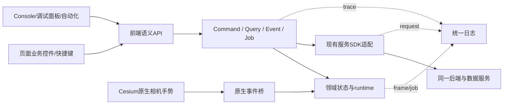

# Web 服务 API、前端交互 API 与日志系统设计

日期：2026-11-14；配套迁移方案 V3。本文是设计规格，未实现的方法不能当成当前可调用 API。

[范围与迁移排期](/Users/user/Desktop/Work/CodeRepo/TimeMachineWeb/docs/unity-web-migration-2026-11-14.md)

## 1. 目标和边界

Web 复用 Unity 同样的后端和数据服务。所有范围内的服务操作有可查询契约；所有用户可感知的页面交互都能通过语义 API 执行、查询和观察完成结果。UI、debug 面板、Console 和自动化脚本使用同一条业务路径。

数值栅格工作台不在范围内：不提供像元改写、笔刷、栅格选区编辑、复制粘贴、公式改值、补洞、地形识别/编纂、栅格操作历史等交互 API。普通要素选中、栅格显示、帧切换、色带和只读查询仍支持。不能借“预留接口”把范围外功能重新加入可执行集合。

这是页面内 API，不是新增 HTTP 服务。原服务接口继续使用原有地址与权限体系，不设新的 Web 专属业务后端或调试后门。

V3实现约束：扩展现有agentActions、RPC telemetry与少量查询/事件函数，不搭建新的通用命令总线、插件系统或任务平台。本规格定义功能契约而非要求新增一整套框架。同步操作正常调用原生Cesium属性/方法，job只用于确实异步的操作。

API暴露业务语义，不逐项代理Cesium的所有方法，也不修改其对象定义。相机的原生鼠标控制可以保留，程序化pan/zoom/view接口调用同一原生控制能力；原生camera事件回读业务快照，避免为了统一入口重写手势物理。状态日志在交互结束或必要采样点记录，不逐pointermove写日志。

## 2. 已有基础与实际差距

| 能力 | 当前代码 | 设计增量 |
|---|---|---|
| 前端 API | v1保留；v2已有53命令声明、目录/执行、三快照和state/job/frame三类有界事件切片 | 新事件当前组合与浏览器验证、完整服务/未来目录、细化输出契约；声明不等于全部可执行 |
| 共用执行 | UI/代理共用handler已有守卫回归；原生相机事件桥已接 | 新P2/P3交互继续共用业务路径，补跨组/多视口生命周期 |
| 参数校验 | 已有嵌套结构、枚举/范围等schema及元数据保护 | 完整结果/事件schema与未来动作覆盖 |
| 完成语义 | projection.select已有accepted/jobs/取消恢复；默认30秒等待、camera.reset回调+帧跟踪及Globe帧队列已在代码中；Atlas单层setTimeAsync候选已有定向回归 | Atlas异常恢复及当前组合/浏览器待验；年代/Atlas/点/Raster联合完成与多视口部分失败尚未齐，time.set仍未解锁完整v2完成语义 |
| 结果保护 | 快照/错误脱敏、日志字段白名单与大小限额 | 无损项目持久化DTO与诊断摘要边界分开，补新事件/结果字段 |
| 请求遥测 | 普通RPC与SharedPlate已有requestId、signal/deadline和结果分类；main/cloud诊断与目录刷新上下文已接线 | 补完整action上下文、当前集成/浏览器与真实服务验证 |
| 后端遥测 | recordTelemetry → 原有RecordTelemetry；尚无生产sink接线 | 明确opt-in、已有feature映射、低频摘要和授权探测；不是新建日志后台 |
| 日志体系 | 有界logger、action/job/普通RPC采集、query/export/clear已有 | 全局异常、Worker/render和完整关联；完整调试面板不是P1前置 |

当前普通RPC已区分transportOutcome与businessOutcome，但只有调用明确提供已知businessSuccessCode才判业务成功/失败，缺省为not-checked。旧outcome保留兼容，不能将HTTP成功直接解释为业务完成；流式headers-received也不等于响应体读取完成。具体调用点和真实协议仍需逐项核实。当前实现与历史验证边界见Goal台账，本文其余章节仍为目标规格。

## 3. 三层契约



### 3.1 服务 API 层

从同一 MetaMaker 生成契约、Invoker 和实际手写 transport 适配中形成服务目录，而不是另写一份容易漂移的 DTO。覆盖本应用使用的账号、项目、资源、文件/对象存储、表数据、模型、Atlas、查询、分析、导出和遥测接口。

每个服务条目包含 serviceId、原模块/方法、路径/协议、请求/响应schema、版本、认证条件、副作用、能力状态、来源位置及 adapter。二进制共享模型解码也要有协议/样本来源，不能只覆盖 JSON API。

完整目录可以预声明暂不可用操作，但状态须区分 `implemented`、`not-implemented`、`server-unavailable`、`permission-required`、`out-of-scope`；声明不代表能执行。后端无权限、不支持版本或当前范围外的操作不得通过通用入口绕过限制。

浏览器中不得直接创建任意 URL 的原始请求执行器。若提供低层服务调试调用，只允许目录中已接入、当前身份可执行的 serviceId；写操作显式调用。通常 debug 应优先调用应用 API，以保持页面状态与服务操作一致。

复用接口仍要核对浏览器 CORS、认证、文件传输和现有 URL 规则。trace 优先在客户端关联；未经既有服务支持，不自动新增请求头或改变签名请求。服务差异单列，不以“兼容”名义重建服务。

### 3.2 前端交互层

所有业务命令先定义输入、输出、状态与完成语义，再接已有handler和UI。控件、API和快捷键共用actionId。原生相机手势复用Cesium输入控制，通过事件桥同步状态；API调用同一原生能力，既不以DOM模拟替代API，也不为了逐事件过注册器重写控制器。

现有稳定 ID 保持不变，例如 `time.set`、`projection.select`、`layer.setVisibility`、`project.save`。新契约通过显式版本扩展，不修改旧脚本所依赖的结果形状。建议保留 root facade v1 的三个方法，并增加 `window.timeMachineAgent.v2`，迁移后再决定是否废弃 v1。

开发时目录应覆盖以下全部模块；下面是命名族示例，最终动作清单由实际 UI/业务清单生成和核对，不能把这些示例当成已穷尽的接口列表。

| 模块 | 必须可调用/观察的交互与查询 |
|---|---|
| 应用与界面 | 模块/侧栏/菜单/面板/弹窗开关、设置、搜索条件、通知、布局 |
| 账户 | 打开登录、登录/退出/发送验证码、第三方登录衔接、账号绑定状态 |
| 项目 | 新建/打开/重命名/保存/另存/克隆/发布及原有删除流程，dirty/saving/error/readonly状态 |
| 资源与目录 | 查询/分页/筛选、选择模型/数据版本、元数据/访问范围和能力状态 |
| 图层与组 | 增删、显隐、透明度、样式、分组/移组/排序、展开/收起、实例状态 |
| 时间与模型 | 设置年代/范围/速度/播放方向、停止、多模型/锚定板块绑定 |
| 视口与相机 | 创建/激活/布局/关闭、投影选择、reset/pan/zoom/view、相机同步与帧状态 |
| 要素与属性 | pick/select/clear、只读框选/过滤、属性分页、当前选中和选择来源 |
| 栅格与Atlas | 显示/色带/波段/帧选择、只读采样、加载进度；无编辑动作 |
| 表格与字段 | 单元格/行/字段编辑、校验、提交、放弃更改、服务端保存状态 |
| 导入与导出 | 注册文件句柄、预览/映射/提交、job进度/取消、生成/下载结果 |
| 图表与只读分析 | 参数、执行/取消、结果、图表样式、已支持的图表导出 |
| 色带 | 节点编辑、CPT/JSON导入、应用/另存、原有资源访问范围 |
| 外部联动 | Explorer/Database结果接收、Mapping转交、会话与结果状态 |
| 诊断 | 能力/状态/接口发现、任务、事件、日志查询/导出/清空、性能摘要 |

### 3.3 调试和自动化层

调试面板通过公开 API 构建：检索接口→按schema生成参数表单→执行→观察任务/状态/事件→查看同trace日志→导出诊断。不能直接改内部 store，也不能另写“仅调试可用”的业务 handler。

Console 可直接调用页面内接口；浏览器自动化通过当前页面上下文调用同一接口。调试面板和完整目录按需加载，核心路由与轻量日志先初始化。现有 facade 的存在不代表已经具备本规格全部能力。

## 4. 拟议 v2 API 与结果语义

以下是契约草案，具体 TS 类型应从统一schema生成或校验。

```ts
interface FrontendApiV2 {
  version: "2.0.0";
  catalog: {
    list(filter?: CatalogFilter): ApiSummary[];
    describe(id: string): Promise<ApiDescriptor | undefined>;
  };
  execute(id: string, input: unknown, options?: ExecuteOptions): Promise<ApiResult>;
  query(id: string, input?: unknown): Promise<ApiResult>;
  events: { subscribe(filter: EventFilter, fn: (event: AppEvent) => void): () => void };
  jobs: {
    get(jobId: string): JobSnapshot | undefined;
    wait(jobId: string, options?: WaitOptions): Promise<ApiResult>;
    cancel(jobId: string): Promise<ApiResult>;
  };
  files: { register(file: File | Blob): FileHandle; release(id: string): void };
  logs: {
    query(filter?: LogFilter): LogPage;
    export(filter?: LogFilter): Blob;
    clear(): void;
  };
}
```

`ApiSummary` 是可立即发现的轻量索引，含id、kind、version、scope、availability、reason和schema引用。`describe` 按需加载完整描述；已知但未实现的ID不会消失。`ApiDescriptor` 至少包括：id、kind（command/query/event/service）、version、scope、inputSchema、outputSchema、requirements、effect、completion、availability、reason、examples。scope 将范围内/范围外与是否已实现分开；能力会随登录、服务版本和当前投影变化。

统一结果示意：

```ts
type ApiResult =
  | { ok: true; status: "completed"; traceId: string;
      revision?: number; data?: unknown }
  | { ok: true; status: "accepted"; traceId: string; jobId: string }
  | { ok: false; status: "failed" | "cancelled" | "superseded" | "unknown";
      traceId: string; jobId?: string; operationRef?: string;
      error: { kind: string; code: string; message: string;
      retryable: boolean; safeDetails?: Record<string, unknown> } };
```

错误类别至少区分 validation、auth、forbidden、unsupported、not-implemented、busy、timeout、network、business、internal。目录预留但无handler的操作返回 not-implemented/unsupported；绝不能返回空成功。

### 4.1 异步与完成条件

- 短命令返回实际完成；长任务可先 accepted+jobId。`execute(..., {completion: "committed"})` 允许等待业务定义的完成点，超时仍能用 jobId 查询，不依赖固定 sleep。
- P0–P3将异步committed等待与`jobs.wait`的缺省timeoutMs固定为30,000ms；调用者可传有限正值（不超过2,147,483,647ms）。accepted模式不等待提交，等待超时不结束后台任务。当前jobs已有该默认值，验证边界见Goal台账第17节；操作自身失败期限及RPC deadline是独立机制，不能把等待超时当作取消确认。
- 等待超时不自动取消任务；任务已建立时，超时结果保留jobId，调用者用jobs.get查询当前状态。jobs.wait超时也保留同一任务身份；没有任务且远端写入结果未知时，返回可用于原服务状态核对的安全operationRef。若原服务没有可核对标识，明确unknown并提示无法自动核实，不编造确认结果。
- `time.set` 完成指目标 generation 的必需图层已经提交、可观察到 committedTimeMa；不等同于 slider 值改变。
- P3联动多视口以单视口完整提交为界；父操作全部参与者成功才completed，部分提交返回failed及有界逐视口摘要，等待超时仍是unknown。参与者/实例关闭和新旧操作规则以P2/P3实施文档第3.3节为准，不引入跨视口事务，不用全局committed年代掩盖差异。
- `project.save` 完成指原后端确认保存并更新本地保存状态；上传完成不等于解析完成；导出任务成功不等于操作系统已保存文件。
- 事件基础字段为bootId、sequence、revision；只有具备唯一操作来源的事件附traceId/jobId。合并多个变化的state.changed通过revision回查快照，不能强绑某一个动作trace。订阅返回取消函数，诊断事件缓冲有界。先订阅再查询状态，或按revision检查，避免查询/订阅之间丢变化。
- `jobs.wait` 读取权威任务状态，不仅等一次事件。重载页面的旧任务不能假装仍存活；用bootId区分，具备原后端jobId的任务可以重新查询，其余明确失效。
- 取消本地等待与取消远端任务分开。服务不支持取消时返回说明；远端写请求超时可能是 unknown，先查询实际状态，不能直接报告失败并自动重发。
- 连续时间/相机输入可合并，旧generation返回superseded；所有结果通过状态revision防止旧响应覆盖新状态。

拟议调用例子（当前 v1 尚不支持这些扩展）：

```js
const api = window.timeMachineAgent.v2;
const descriptor = await api.catalog.describe("time.set");
// 参数按descriptor.inputSchema构造；此处假定v2使用ageMa。
const result = await api.execute("time.set", { ageMa: 100 }, {
  completion: "committed", timeoutMs: 15000
});
const scene = await api.query("scene.snapshot");
const logs = api.logs.query({ traceId: result.traceId, limit: 100 });
```

示例不授权任何额外服务操作；schema、query ID 和 option 是设计草案。现有 v1 参数名应在实现时保留或通过明确的v2适配映射。

### 4.2 文件、平台权限和副作用

文件用 File/Blob 或有生命周期的 fileHandle 注入导入流程，不要求自动化操控原生文件选择框；内容不进入日志。下载、剪贴板、弹窗和第三方登录仍遵守浏览器权限/用户手势规则，API不能绕过。受限制时返回可理解的状态与下一步，不虚报完成。

副作用标记为 read、ui-local、project-local、remote-write。普通查询和本地界面脚本可用于复现；保存、上传、发布、删除不自动重放。只有原服务支持时才使用幂等键；超时后的写入结果应查询确认。API执行与UI具有相同权限和业务前置条件，不能以debug为由绕过。

## 5. 日志系统

### 5.1 结构与关联

```ts
interface LogEvent {
  timestamp: string;            // UTC时间用于跨系统对齐
  monotonicMs: number;          // 页面内耗时排序
  sequence: number;
  level: "debug" | "info" | "warn" | "error";
  category: "app" | "action" | "rpc" | "asset" | "worker" | "render" | "performance";
  event: string;
  bootId: string;
  appVersion: string;
  traceId?: string;
  parentId?: string;
  actionId?: string;
  requestId?: string;
  jobId?: string;
  projectId?: string;
  layerId?: string;
  viewportId?: string;
  generation?: number;
  revision?: number;
  durationMs?: number;
  outcome?: string;
  errorCode?: string;
  safeDetails?: Record<string, unknown>;
}
```

一次操作的典型链：action.started → rpc.started/completed 或 worker.started/completed → frame.committed/state.changed → action.completed。每个操作局部携带上下文，不能用一个全局currentTrace变量处理并发。共享资源请求可能服务多个action，采用requestId与显式关联关系，不能强行归给最后一个请求者。

错误收集覆盖应用边界、未捕获异常/unhandled rejection、Worker error、RPC/业务失败、资源解析失败、WebGL/render错误。记录最初原因并保留后续上下文，不在每层重复上传同一异常。

### 5.2 输出与容量

| 输出 | 用途 | 行为 |
|---|---|---|
| 内存环形缓冲 | 即时debug与关联查询 | 建议初始上限2000条且总编码体积≤2 MiB，先触及者淘汰；记录dropCount |
| 开发console | 开发者快速查看 | 使用统一formatter与过滤，不靠散落console构成系统 |
| 诊断导出 | 复现/交付排查 | 脱敏JSONL日志、版本、能力、状态摘要、任务与性能信息；不包含数据文件 |
| 可选本地持久化 | 重载前后的错误排查 | 仅显式开发会话启用，有TTL/容量/清空；默认不开无限写入 |
| 原有RecordTelemetry | 必要摘要指标 | 能力可用才启用、有限队列与速率；不传原始日志流 |

容量是建议初始值，P1实测调整。单条事件大小和字符串深度也限额；异常栈可截断。高频拖动/播放记录开始/结束与汇总，不逐帧输出完整状态。

生产默认关闭高频debug，保留错误与必要指标；临时debug按会话启用、到期关闭。调试面板、导出器和完整目录按需加载。API调用与轻量缓冲常驻，遥测网络不等待首帧。

### 5.3 复用现有遥测服务

原有 `recordTelemetry` 已映射 EventName、DurationMs、Success、CorrelationID、DimensionList 等字段。使用它上报低频摘要，不假定它支持整批日志、存储检索或链路查询。遵守现有字段约束，例如 CorrelationID 长度和 DimensionList 数量上限；不手改生成 DTO。

默认关闭远端sink；明确opt-in、已有业务feature的合法映射与服务能力验证后再启用。当前没有Telemetry专用Feature值，不臆造枚举；无合法映射的诊断只保留本地。真实RecordTelemetry探测属于远端写入，需受授权的测试环境与摘要，不能计作只读服务验证。

如果服务版本没有该能力，本地日志和诊断仍正常工作；不新建服务作为前置条件。遥测自身请求不再产生可上报遥测，避免递归；sink异常被隔离。普通读请求可有限重试，写请求遵守原接口幂等语义。

客户端trace可以完整覆盖action、Worker、渲染与其发出的RPC。若原后端没有接收业务trace的机制，只能在客户端记录关联，不能声称已经实现服务端内部全链路追踪；已有服务返回的请求ID可以关联展示。

### 5.4 数据保护

日志采用事件级字段白名单，而不是先记录全部参数再依赖正则清洗。不得记录密码、Token、Authorization、认证摘要、完整签名URL、上传内容、原始表格数据或完整服务响应。错误message/stack仍需脱敏、截断；资源链接只留安全的资源ID/路径模板，不保留查询字符串。

敏感输入不能进入可重放脚本。诊断快照只提供有界摘要，避免巨型数组和私有数据泄漏。API结果沿用现有脱敏保护；日志的白名单是额外控制，不能用API原始参数作为safeDetails。

## 6. 开发流程与验收

P0建立两个目录和一张覆盖表：服务目录、前端交互目录、功能→控件/快捷键→action/query→服务→事件/日志→用例。生成目录来自同一契约和注册表，文档与调试面板消费同一份数据，避免手工维护多份列表。

每个功能的完成条件：

1. 声明接口、输入/输出schema、错误、能力状态、副作用和完成点；无实现时可发现且明确不可执行。
2. 业务命令实现唯一应用handler，UI与API共用；原生相机手势通过事件桥同步。所有业务状态可通过查询读取。
3. 异步行为有进度/终态/取消说明，过期结果不能覆盖新状态。
4. 结构化日志关联到action、服务请求或Worker，以及最终revision/frame；失败可诊断。
5. 自动化通过API跑功能用例；另做少量真实UI接线测试，证明按钮调用同一handler、原生相机手势与程序化命令得到一致的可查询状态和日志，不能只测handler。
6. 真实服务集成用同账号、同资源验证；mock仅用于隔离开发，不证明远端闭环已完成。

阶段验收重点：

- 所有范围内已交付交互均出现在目录，覆盖率按已确认语义操作计算；未实现也预声明，数量不能冒充完成度。
- 对同初始状态分别走UI/API，得到相同业务状态和原有服务调用；表格/上传/发布等不是仅API返回成功。
- HTTP 200业务错误、超时、取消、Worker失败、渲染失败、服务不可用都有明确信息和trace。
- 未启用或范围外接口不可执行；没有无需权限的低层远端调用通道。
- 日志容量受限、dropCount可见、敏感样本不泄漏；遥测服务断开不影响应用功能。
- 第一可用帧预算包含核心API和日志开销；完整目录/调试工具不被意外打进入口依赖。
- 诊断包可以解释一次失败的用户操作，无需人工从多份console截图拼接过程。

## 7. 当前代码证据

[前端facade契约与脱敏 types.ts:25](/Users/user/Desktop/Work/CodeRepo/TimeMachineWeb/src/agent-actions/types.ts:25)

[注册、发现和执行 registry.ts:114](/Users/user/Desktop/Work/CodeRepo/TimeMachineWeb/src/agent-actions/registry.ts:114)

[RPC遥测定义 rpc-client.ts:11](/Users/user/Desktop/Work/CodeRepo/TimeMachineWeb/packages/api-client/src/rpc-client.ts:11)

[请求与HTTP/业务结果 rpc-client.ts:181](/Users/user/Desktop/Work/CodeRepo/TimeMachineWeb/packages/api-client/src/rpc-client.ts:181)

[原有遥测适配 platform-runtime/src/index.ts:98](/Users/user/Desktop/Work/CodeRepo/TimeMachineWeb/packages/platform-runtime/src/index.ts:98)

[原后端RecordTelemetry实现](/Users/user/Desktop/Work/CodeRepo/TimeMachineWeb/DPlanet/Server/ServiceDPlanet/Service/TimeMachine/TimeMachinePlatformService.cs:49)

[生成遥测契约与字段限制](/Users/user/Desktop/Work/CodeRepo/TimeMachineWeb/DPlanet/TypeScript/src/code_ex/d_planet/struct/time_machine_telemetry_vo.ts:15)

[当前性能监控 performance-monitor.ts:31](/Users/user/Desktop/Work/CodeRepo/TimeMachineWeb/src/ui/performance-monitor.ts:31)
